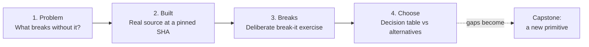

# The four-pass method

Every primitive in this course is taught in the same four passes. The passes are deliberately in this order: you can't judge alternatives until you know the failure modes, and you can't find failure modes until you've read how it's built.

## Pass 1: the problem it solves

Start without the primitive. What would you write by hand, and what goes wrong? In Module 1 you literally write the agent loop, a journal, and a fencing check by hand, so that later "Mastra does X" reads as "Mastra solved the problem I already hit".

Questions to answer in pass 1:
- What invariant does this primitive protect? (e.g. "one run per thread", "a completed step is never redone")
- What is the cheapest thing that almost works, and what is its failure?

## Pass 2: how it's built in real source

Every lesson links to exact files and lines in `mastra-ai/mastra` at a pinned commit, `ebe143c4`. Read the code before you read the docs. Then read the **tests** next to it: tests are the most honest specification of what the authors think the primitive guarantees.

Reading checklist:
- Where is the entry point? Where is the state stored (memory, storage, PubSub)?
- What is serializable and what is not? (Mastra keeps non-serializable per-run state in `runScope`.)
- Which tests cover the edge cases, and which edge cases have no test?

## Pass 3: where it breaks

Each full module has a **break-it** exercise: starter code that contains a deliberate, realistic bug (a runaway loop, a lost update, a leaked secret across stream chunks, a double deploy after a crash). The test suite fails on the starter code; you fix it; the test passes. CI verifies that the starter code really is broken, so the exercises stay honest as Mastra evolves.

Break-it exercises are chosen to show the **boundary of the primitive's guarantee**: the place where the framework stops protecting you and you have to.

## Pass 4: when to choose something else

Every module ends with a decision table:

| Use it when | Don't use it when | Alternatives |
|---|---|---|
| … | … | Temporal, LangGraph, Inngest, Vercel AI SDK, Restate, DBOS, plain code … |

and a short comparison with one other framework. The tables are collected in the [cheat sheet](/cheatsheet).

## From understanding to design

The last module turns gaps you found into **new primitives**. The RFC template asks for the problem, prior art (how Temporal/Restate/LangGraph do it), the design, failure modes, and fit with Mastra's house rules:

1. Prefer a processor over new core API.
2. Everything durable or observable is a workflow step.
3. One message timeline (MessageList) for everything the model sees.
4. The thread is the unit of concurrency.
5. Fail open on coordination, fail loudly on correctness.
6. Local first, then distributed: swap the transport, not the API.
7. Treat external and peer text as untrusted.
