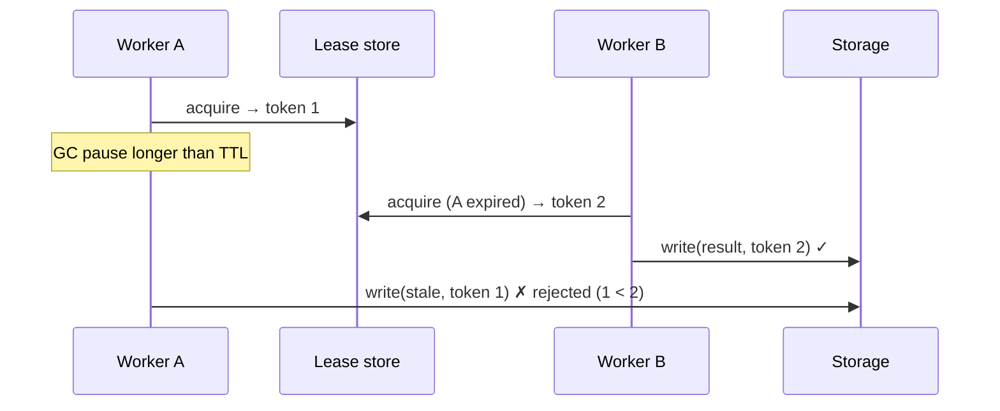

<script setup>
const outcomes = [
  'Write an agent loop from scratch and explain each hardening decision',
  'Explain why a journal makes finished steps exactly-once but the in-flight step only at-least-once',
  'Close that gap with an idempotency key, and stop a zombie worker with a fencing token',
  'Tell a <em>request</em> from a <em>signal</em>, and say when a signal gets seen',
  'Recognise the same ideas when Mastra shows them to you in Modules 2 to 7',
]
const naive = [
  { title: 'It never stops', body: '"Until no tool calls" trusts the model. A confused model calls the same tool forever, on your card.', icon: 'reset', color: 'coral' },
  { title: 'One flaky API kills it', body: 'A tool throws and the whole run dies, instead of the model reading the error and trying something else.', icon: 'alert', color: 'amber' },
  { title: 'Order changes every run', body: '`Promise.all` and push-as-they-finish means the next prompt depends on network timing. Replays stop matching.', icon: 'cards', color: 'violet' },
  { title: 'Nowhere to hook in', body: 'Redaction, trimming, memory: all string-concatenated into the prompt in random places.', icon: 'wrench', color: 'sky' },
  { title: 'Mid-run messages race', body: 'The user types while the agent works. You start a second loop. Two loops, one transcript.', icon: 'mail', color: 'teal' },
  { title: 'A crash loses everything', body: 'It all lives in memory. Kill the process and the run, and any half-done work, is gone.', icon: 'skull', color: 'lime' },
]
const decisions = [
  { title: '`maxSteps` is a budget, `stopWhen` is a policy', body: 'One caps the damage. The other decides you are done, or stuck.', icon: 'clock' },
  { title: 'Tool errors become data', body: '`{ error }` goes back to the model, so it can recover.', icon: 'alert' },
  { title: 'Results fold back in call order', body: 'Not completion order. The next prompt is deterministic, which replay and caching need.', icon: 'cards' },
  { title: 'Hooks wrap the model call', body: 'One place to redact, trim and inject. The seed of Mastra **processors** (Module 3).', icon: 'wrench' },
  { title: 'Signals wait for a safe point', body: 'Drained at the top of a step, never mid-tool. The seed of Mastra **signals** (Module 6).', icon: 'mail' },
  { title: 'Everything else is hardening', body: 'Streaming, threads, memory, durability: the rest of the course.', icon: 'star' },
]
const limits = [
  { title: 'Lives in memory', body: 'A crash loses the run. → Module 7, durability.', icon: 'skull', color: 'coral' },
  { title: 'Unbounded fan-out', body: '`Promise.all` has no concurrency limit and no cancellation. → Module 2.', icon: 'bolt', color: 'amber' },
  { title: 'Per-process mailbox', body: 'No persistence, no priority, no cross-process delivery. → Module 6.', icon: 'mail', color: 'sky' },
  { title: 'Naive journal keys', body: 'Loops need an iteration in the key, and code changes between crash and replay go unnoticed.', icon: 'book', color: 'violet' },
]
const q_order = [
  { text: 'Oslo first: it finished first, and fresher results are better', why: 'That is completion order. It changes with network timing, so two runs of the same input produce different prompts.' },
  { text: 'Lisbon, then Oslo: the order the model asked for them', correct: true, why: 'Call order. The next prompt is a pure function of what the model asked for and what the tools returned.' },
  { text: 'Random, it does not matter', why: 'It matters a lot once you want replay, caching or tests that pin a prompt.' },
]
const q_window = [
  { text: 'Nothing. The journal saw the key, so replay skips the charge', why: 'The journal is written *after* the effect. The crash happened before that write, so the key is not there.' },
  { text: 'The charge runs again: the customer is charged twice', correct: true, why: 'That is the at-least-once window. The effect happened, the record of it did not.' },
  { text: 'The run fails with a non-determinism error', why: 'That is what happens when a replay asks for steps in a different order. Here the order is the same.' },
]
const q_fence = [
  { text: 'Worker A: it acquired the lease first', why: 'A\'s lease expired during its pause. It just does not know that yet.' },
  { text: 'Worker B: token 2 beats token 1, and storage rejects the stale write', correct: true, why: 'The storage layer remembers the highest token it has seen and refuses anything lower.' },
  { text: 'Whoever writes last', why: 'That is last-writer-wins, the bug Exercise 1.3 asks you to fix.' },
]
const q_signal = [
  { text: 'Right away: the tool is interrupted', why: 'Signals are cooperative. Nothing interrupts a running tool.' },
  { text: 'At the top of the next step, when the loop drains the mailbox', correct: true, why: 'Safe points only. The tool finishes, results fold back, and the next step starts by draining signals.' },
  { text: 'Never, it was sent while the agent was busy', why: 'The mailbox keeps it. Busy is exactly when a mailbox helps.' },
]
const choose = [
  { name: 'Hand-written loop', when: 'Learning, or one short tool-using call in a script', not: 'You need memory, streaming to clients, guardrails or recovery', alt: 'AI SDK `generateText` + `stopWhen`; a Mastra `Agent`' },
  { name: 'Journal (`ctx.run`)', when: 'Multi-step work with expensive or external side effects that must survive restarts', not: 'Pure, cheap, idempotent work (just recompute)', alt: 'Temporal activities, Restate `ctx.run`, DBOS steps, Inngest `step.run`' },
  { name: 'Idempotency key', when: 'Any external write that might be retried', not: 'Reads, or naturally idempotent writes (PUT a full value)', alt: 'Dedup tables, the outbox pattern, transactional writes' },
  { name: 'Fencing token', when: 'More than one worker can hold the same run', not: 'A strictly single-instance deployment', alt: 'Row versions (optimistic concurrency), single-writer queues' },
  { name: 'Signal mailbox', when: 'News should reach a busy agent without a new run', not: 'The caller needs an answer now', alt: 'Request/response, a run per message, a queue + consumer' },
]
const recall = [
  { q: 'Write the agent loop in four lines of pseudocode.', a: 'Ask the model with messages + tool specs → append the turn → no tool calls? return the text → run each call, append results (in call order), repeat.' },
  { q: 'What does a journal guarantee, and what does it not?', a: 'Completed steps are exactly-once (replayed from the journal). The in-flight step is only at-least-once: a crash between the effect and the journal write repeats it.' },
  { q: 'Who closes the at-least-once window?', a: 'The **receiver**, by deduping on an idempotency key such as `runId:charge`. Journal + key = exactly-once-effective.' },
  { q: 'Why is a lease alone not enough?', a: 'A paused worker does not know its lease expired. Only storage that rejects lower fencing tokens can stop its stale write.' },
  { q: 'When does a signal sent mid-tool get seen?', a: 'At the next safe point, the top of the next step. Signals are cooperative, not preemptive.' },
  { q: 'What should a journal key identify?', a: 'The effect (its name, plus an iteration for loops), never its position. Position-based keys hand one effect another\'s result after a code change.' },
]
const cheat = [
  { title: 'The loop', color: 'violet', lines: ['ask model → tool calls? → run tools → fold back (call order) → repeat', 'maxSteps = budget, stopWhen = policy', 'tool errors are data, hooks wrap the model call'] },
  { title: 'Journal', color: 'amber', lines: ['ctx.run(key, fn): replay returns the saved result', 'finished steps: exactly-once', 'in-flight step: at-least-once (crash after effect, before write)'] },
  { title: 'Idempotency key', color: 'teal', lines: ['receiver dedupes the same key', 'key = stable run id + effect name', 'journal + key = exactly-once-effective'] },
  { title: 'Fencing token', color: 'coral', lines: ['every lease grant gets a bigger token', 'every write carries it', 'storage rejects lower tokens: zombies cannot write'] },
  { title: 'Request vs signal', color: 'sky', lines: ['request: caller waits for one answer', 'signal: a letter in a mailbox', 'busy → deliver at next safe point; idle → wake or keep'] },
  { title: 'Seen next in Mastra', color: 'lime', lines: ['loop → Module 2', 'hooks → processors (Module 3)', 'mailbox → signals (Module 6)', 'journal + fencing → durable agents (Module 7)'] },
]
const out1 = '{"type":"step-start","step":0}\n{"type":"model-request","step":0,"messages":1}\n{"type":"tool-call","step":0,"call":{"id":"c1","name":"weather","args":{"city":"Lisbon"}}}\n{"type":"tool-call","step":0,"call":{"id":"c2","name":"weather","args":{"city":"Oslo"}}}\n{"type":"tool-result","step":0,"id":"c1","result":{"city":"Lisbon","tempC":24}}\n{"type":"tool-result","step":0,"id":"c2","result":{"city":"Oslo","tempC":9}}\n{"type":"step-finish","step":0}\n{"type":"step-start","step":1}\n{"type":"model-request","step":1,"messages":4}\n{"type":"step-finish","step":1}\n{"type":"finish","reason":"stop","steps":2}\ntext: Lisbon is warmer than Oslo. | finishReason: stop | steps: 2'
</script>

# Module 1: First principles before Mastra

<p class="lead">Before we open a single Mastra file, you're going to build the three ideas everything else rests on, by hand: the agent loop, durable execution, and signals. When Mastra shows you its versions later, they'll feel like old friends in better clothes.</p>

<LessonHero module="01" :minutes="45" lab="Lab runs in < 1 s, plain Node" :outcomes="outcomes" mood="alarmed">

**Saturday hackathon, 4:47 pm.** Your 190-line agent charges a customer's card, then kicks off a 10-minute deploy. At minute 6 the cloud reclaims your spot instance.

The process restarts. Your code, very helpfully, starts the job from the top. **The customer gets charged again.** Their email to support has a lot of capital letters in it.

</LessonHero>

<Journey :station="1" module="01" />

## The problem {#problem}

A single LLM call answers once. An **agent** acts: call a tool, look at the result, decide again. The smallest correct version fits on a napkin:

```txt
messages = [system, user]
repeat:
    turn = model(messages, toolSpecs)
    messages += turn
    if turn has no tool calls: return turn.text
    for each call in turn.toolCalls: messages += execute(call)
```

That's genuinely it. Everything else, in every agent framework, is **hardening**. And the napkin version breaks in at least six ways:

<IdeaCards :cards="naive" />

<MascotSays mood="thinking">

Notice that only the last card is about crashes. Five out of six problems show up on a perfectly healthy machine. Durability is the famous one, but it's not the only one.

</MascotSays>

<StationDone module="01" :station="1" />

<Journey :station="2" module="01" />

## Under the hood {#under-the-hood}

This station has three stops: the loop, the journal, and the mailbox. You'll build each one yourself.

### Stop 1: a loop you can trust

<LoopSketch />

[`loop-from-scratch.ts`](https://github.com/rphansen91/mastra-primitives-course/blob/main/labs/m01-first-principles/loop-from-scratch.ts) is a complete loop in about 190 lines. Here's its heart:

```ts
for (let step = 0; step < maxSteps; step++) {
  // Safe point: signals that arrived since the last step join the transcript
  for (const s of signals?.drain() ?? []) messages.push({ role: 'user', content: `<signal>${s}</signal>` });

  let request = messages;
  for (const h of hooks) if (h.beforeModel) request = await h.beforeModel(request, step); // ← processors
  let turn = await model(request, specs);
  ...
  if (calls.length === 0) { finishReason = 'stop'; break; }
  const results = await Promise.all(calls.map(exec));                       // fan out
  calls.forEach((call, i) => messages.push(toolMessage(call, results[i]))); // fold back IN CALL ORDER
  const reason = stopWhen.map(c => c(steps)).find(Boolean);                 // custom stop conditions
  if (reason) { finishReason = reason; break; }
}
```

Six decisions hide in there. Mastra makes every one of them too:

<IdeaCards :cards="decisions" />

<Quiz kind="predict" module="01" id="call-order" question="The model asks for `weather(Lisbon)` then `weather(Oslo)` in one turn. Oslo's API answers first. In what order do the results land in the next prompt?" :options="q_order" />

<TryIt cmd="npm run lab:loop-from-scratch" :output="out1">

Two parallel tool calls, folded back in call order (`c1` then `c2`), then a final answer.

</TryIt>

### Stop 2: surviving a crash

Back to the hackathon. On restart, re-running from scratch charges the card twice. Not re-running leaves the deploy half done. Durable engines (Temporal, Restate, DBOS, Inngest, Cloudflare and Vercel Workflows) all answer with the same three tools.

**Tool one: the journal.** Wrap every side effect in `ctx.run(key, fn)`. First time through, run `fn` and write down the result. On replay, hand back the written-down result instead of running `fn` again.

```ts
async run<T>(key: string, fn: () => Promise<T>): Promise<T> {
  const k = `${this.runId}:${key}`;
  if (this.journal.has(k)) return this.journal.get(k) as T;   // replay
  const value = await fn();                                    // the effect happens here
  // ← a crash HERE is the at-least-once window
  this.journal.set(k, value);
  return value;
}
```

<JournalTimeline />

<Callout type="analogy" title="The restaurant order pad">

A waiter writes each dish on the pad *after* the kitchen fires it. If the waiter faints between "kitchen fired the steak" and "wrote it down", the next waiter reads the pad, sees no steak, and fires another one. The pad (journal) can't fix that gap. Only the kitchen can, by noticing "table 7 already has a steak" (an idempotency key).

</Callout>

<Quiz kind="predict" module="01" id="crash-window" question="The process dies right after `payments.charge()` returns, before `journal.set()`. What happens on replay?" :options="q_window" />

**Tool two: the idempotency key.** The only way to close that window is for the *receiver* to dedupe. Stripe and most payment APIs accept a key: same key twice means "same request, give me the first result".

```ts
await payments.charge(500, `${runId}:charge`); // retried after a crash → applied once
```

Journal plus idempotency key gives you **exactly-once-effective**. Go break it yourself. Kill the job at different moments, with and without the journal and the key:

<CrashSimulator variant="journal" />

**Tool three: the fencing token.** What if *two* workers both think they own the run? Say worker A pauses for a long GC (or a laptop lid closes), its lease expires, and worker B takes over. Then A wakes up, not knowing any of this, and writes its stale result.

The fix (Martin Kleppmann's *fencing token*): every lease grant gets a bigger number, every write carries it, and **storage** rejects any write with a smaller number than it has already seen.



<Quiz module="01" id="fence" question="Both workers write a result for the same run. Whose result survives?" :options="q_fence" explain="Mastra's durable agents do exactly this at the pinned commit: run claims with generations, and `RunFenceConflictError` on stale writes. You'll meet it in Module 7." />

### Stop 3: requests vs signals

A **request** expects an answer now. An **event** (a *signal*) is a fact dropped in a mailbox, and the receiver decides when to read it. Agents need both.

<RequestVsSignal />

In the from-scratch loop, `SignalQueue` is the mailbox and "top of each step" is the safe point. That has a consequence that's also true in Mastra:

<Quiz module="01" id="signal-when" question="A user message arrives while a 10-minute tool is running. When does the model see it?" :options="q_signal" />

<DeepDive title="Where these ideas live in Mastra">

- [`loop/loop-builder.ts`](https://github.com/mastra-ai/mastra/blob/81299c921d6f499d4c62f14c38e4d4d88b4fbfae/packages/core/src/loop/loop-builder.ts#L83): Mastra's loop is a `dowhile` workflow. Compare it with your `for` loop.
- [`loop/shared/continuation-core.ts`](https://github.com/mastra-ai/mastra/blob/81299c921d6f499d4c62f14c38e4d4d88b4fbfae/packages/core/src/loop/shared/continuation-core.ts): `decideContinuation`, Mastra's version of your stop conditions.
- [`workflows/default.ts` `wrapDurableOperation`](https://github.com/mastra-ai/mastra/blob/81299c921d6f499d4c62f14c38e4d4d88b4fbfae/packages/core/src/workflows/default.ts#L173): the seam where a durable engine plugs in a journal (a no-op on the default engine).
- [`agent/durable/execution-fence.ts`](https://github.com/mastra-ai/mastra/blob/81299c921d6f499d4c62f14c38e4d4d88b4fbfae/packages/core/src/agent/durable/execution-fence.ts#L36): run claims, TTL 30 s, renewed every 10 s.
- [`stores/pg/.../run-fencing.ts`](https://github.com/mastra-ai/mastra/blob/81299c921d6f499d4c62f14c38e4d4d88b4fbfae/stores/pg/src/storage/db/run-fencing.ts): fencing, implemented in the storage adapter where it belongs.
- [`durable-operation-ids.test.ts`](https://github.com/mastra-ai/mastra/blob/81299c921d6f499d4c62f14c38e4d4d88b4fbfae/packages/core/src/workflows/durable-operation-ids.test.ts): how Mastra keys durable operations (run id + execution path + phase).

</DeepDive>

<StationDone module="01" :station="2" />

<Journey :station="3" module="01" />

## Break it {#break-it}

Three starter files, three planted bugs. Each one is a bug real systems have shipped.

<IdeaCards :cols="3" :cards="[{ title: '1.1 The runaway loop', body: 'The model calls `search(&quot;same thing&quot;)` forever. Write `stopOnRepeat(n)` so it stops with `loop-detected`, not `max-steps`.', icon: 'reset', color: 'coral', tag: 'exercises/ex1-loop-guard.ts' }, { title: '1.2 Keys by position', body: 'The journal keys effects as `step-0`, `step-1`. A config flip between crash and replay hands `getOrders` the user record.', icon: 'book', color: 'amber', tag: 'exercises/ex2-journal-keys.ts' }, { title: '1.3 A lease without a fence', body: 'Worker A stalls, B takes over, A wakes and overwrites B. Make the store reject stale tokens.', icon: 'skull', color: 'violet', tag: 'exercises/ex3-fencing.ts' }]" />

<TryIt cmd="LAB_TARGET=exercises node --import tsx --test m01-first-principles/break-it.test.ts">

Three tests fail on the starter code. Fix the files until they pass. Hints and full solutions are on the [Break it page](./break-it).

</TryIt>

And four limits of what you built, each of which a later module fixes:

<IdeaCards :cols="2" :cards="limits" />

<StationDone module="01" :station="3" />

<Journey :station="4" module="01" />

## Choose wisely {#choose-wisely}

<Callout type="analogy" title="The AI SDK is your napkin loop, professionally printed">

The Vercel AI SDK's `generateText` / `streamText` with tools and `stopWhen: stepCountIs(n)` is very close to what you just built: steps, stop conditions, results folded back.

What it deliberately leaves out: threads and memory, a signal mailbox, processors as a unit of composition, and durability. Mastra uses the same model interface (`LanguageModelV2`/`V3`) and the same step semantics, then adds those. That's why the labs can use an AI-SDK-shaped mock model.

</Callout>

<Choose :rows="choose" />

<StationDone module="01" :station="4" next="./lab" next-label="On to the lab" />

## Wrap-up

<Podcast title="First principles, in five minutes" :minutes="5">

**Host:** We wrote an agent by hand today. How small can one be?

**Loopy:** Four lines. Ask the model. If it wants tools, run them and add the results. Otherwise return its answer. Repeat.

**Host:** So why are frameworks so big?

**Loopy:** Hardening. A model can loop forever, so you need a step budget, and a stop policy that notices when it's stuck. Tools fail, so errors become data the model can read. Parallel tools finish in random order, so you fold results back in the order the model asked. And you want one place to hook in, which becomes processors later.

**Host:** Then the crash.

**Loopy:** Right. The card got charged, the process died, and the restart charged it again. The fix is a journal: wrap each side effect, write down its result, and on replay hand back the result instead of redoing it.

**Host:** Problem solved?

**Loopy:** Almost. If you crash after the effect but before writing it down, the journal never heard about it, so it runs again. That's the at-least-once window. Only the receiver can close it, with an idempotency key. Same key twice, charge once.

**Host:** And the zombie worker?

**Loopy:** Two workers think they own one run. Leases help, but a paused worker doesn't know its lease ran out. So every lease gets a bigger number, a fencing token, and storage refuses writes with a smaller one.

**Host:** Last idea: signals.

**Loopy:** A request is a phone call. Someone waits for an answer. A signal is a letter in a mailbox. The agent reads it at the next safe point, the top of the next step. Never in the middle of a tool.

</Podcast>

<Recall module="01" :cards="recall" />

<CheatCard module="01" title="First principles" subtitle="The loop, the journal and the mailbox, before any framework" :cells="cheat" />

<Callout type="win" title="Where next">

- **[Lab 1](./lab):** run the loop and the durability helpers.
- **[Break it](./break-it):** the three exercises, with solutions.
- **[Check your understanding](./quiz)**
- **[Module 2: The agent loop](/m02/):** your loop, Mastra-sized.

</Callout>
