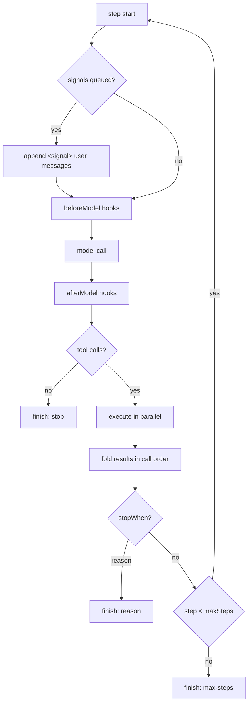
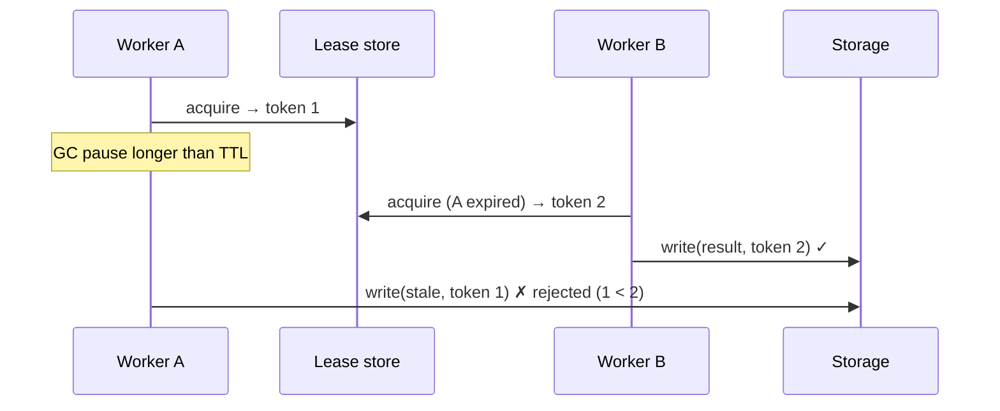

# Module 1: First principles before Mastra

**Goal:** build the three ideas every later module depends on, by hand, with no framework: (1) the agent loop, (2) durable execution (journals, idempotency, fencing), (3) events/signals versus requests. When you meet Mastra's versions in Modules 2 to 7 they should feel like "oh, that's my loop, hardened".

**Lab:** [`labs/m01-first-principles`](https://github.com/rphansen91/mastra-primitives-course/tree/main/labs/m01-first-principles) · [Lab guide](./lab) · [Break it](./break-it) · [Quiz](./quiz)

## 1.1 The agent loop is a while loop

### Pass 1: the problem

An LLM call answers once. An *agent* needs to act: call a tool, look at the result, decide again. The smallest correct program is:

```
messages = [system, user]
repeat:
    turn = model(messages, toolSpecs)
    messages += turn
    if turn has no tool calls: return turn.text
    for each call in turn.toolCalls: messages += execute(call)
```

Everything else is hardening. The hardening is where the design decisions live:

| Concern | Naive version | What goes wrong |
|---|---|---|
| Stopping | "until no tool calls" | The model loops forever on the same tool, or burns your budget |
| Tool errors | let them throw | One flaky API kills the whole run, instead of letting the model recover |
| Parallel tool calls | `Promise.all` and push results as they finish | Non-deterministic prompt order; replays don't match |
| Context injection | string-concatenate into the prompt | No single place to redact, trim, or add memory |
| Messages arriving mid-run | start another loop | Two loops race over one transcript |

### Pass 2: build it

[`loop-from-scratch.ts`](https://github.com/rphansen91/mastra-primitives-course/blob/main/labs/m01-first-principles/loop-from-scratch.ts) is a complete loop in about 190 lines. Read it top to bottom; the key decisions are commented:

```ts
for (let step = 0; step < maxSteps; step++) {
  // Safe point: signals that arrived since the last step join the transcript
  for (const s of signals?.drain() ?? []) messages.push({ role: 'user', content: `<signal>${s}</signal>` });

  let request = messages;
  for (const h of hooks) if (h.beforeModel) request = await h.beforeModel(request, step); // ← processors
  let turn = await model(request, specs);
  ...
  if (calls.length === 0) { finishReason = 'stop'; break; }
  const results = await Promise.all(calls.map(exec));      // fan out
  calls.forEach((call, i) => messages.push(toolMessage(call, results[i])));  // fold back IN CALL ORDER
  const reason = stopWhen.map(c => c(steps)).find(Boolean); // custom stop conditions
  if (reason) { finishReason = reason; break; }
}
```

Five design decisions to notice, because Mastra makes the same ones:

1. **`maxSteps` is a budget, `stopWhen` is a policy.** Two different mechanisms.
2. **Tool errors become data** (`{ error }`), so the model can react.
3. **Results fold back in call order**, not completion order. The next prompt is deterministic, which matters for replay and caching.
4. **Hooks wrap the model call.** That's the seed of Mastra *processors* (Module 3).
5. **Signals are drained at a safe point** (the top of a step), never injected mid-tool. That's the seed of Mastra *signals* (Module 6).



## 1.2 Durability: journals, idempotency keys, fencing

### Pass 1: the problem

Your agent charged a card, then started a 10-minute deploy, and the process was killed (deploy, OOM, spot instance). What should happen on restart?

- Re-running from scratch charges the card again.
- Not re-running leaves the deploy half done.

Durable execution engines (Temporal, Restate, DBOS, Inngest, Cloudflare/Vercel Workflows) answer with three mechanisms. You'll build each in [`durability.ts`](https://github.com/rphansen91/mastra-primitives-course/blob/main/labs/m01-first-principles/durability.ts).

### The journal

Wrap every side effect in `ctx.run(key, fn)`. The first time, run `fn` and record the result under `key`. On replay after a crash, return the recorded result instead of running `fn` again.

```ts
async run<T>(key: string, fn: () => Promise<T>): Promise<T> {
  const k = `${this.runId}:${key}`;
  if (this.journal.has(k)) return this.journal.get(k) as T;   // replay
  const value = await fn();                                    // effect happens here
  // ← a crash HERE is the at-least-once window
  this.journal.set(k, value);
  return value;
}
```

Two properties fall out:

- **Completed steps are exactly-once.** Their results come from the journal.
- **The in-flight step is at-least-once.** If the process dies between "effect happened" and "journal written", replay runs it again. No journal can close this window by itself.

The **key** must identify the effect, not its position. Exercise 1.2 shows what happens when you key by a counter.

### Idempotency keys

The only way to close the at-least-once window is for the *receiver* of the effect to dedupe. Stripe, most payment APIs, and well-designed internal services accept an idempotency key: the same key twice means "same request, return the first result".

```ts
await payments.charge(500, `${runId}:charge`); // retried after a crash → applied once
```

Journal + idempotency key = **exactly-once-effective**. Module 7 does this for a real Mastra durable agent after a `kill -9`.

### Leases and fencing tokens

If two workers can both pick up a run (two replicas boot, or a slow worker comes back after its lease expired), you get two writers. A **lease** gives one owner at a time, but only in wall-clock terms. A worker that paused (GC, laptop sleep, network partition) doesn't know its lease expired.

The fix (Martin Kleppmann's *fencing token*): every lease grant gets a monotonically increasing token, every write carries the token, and **the storage layer** rejects a write with a token lower than one it has already seen.



Mastra's durable agents implement exactly this on main at the pinned commit (run claims with generations, and `RunFenceConflictError` on stale writes); see [Module 7](/m07/).

## 1.3 Events and signals versus requests

A **request** expects an answer now: the caller waits, and there's one reply per request. An **event** is a fact delivered to a mailbox; the receiver decides when to process it. Agent systems need both:

| | Request | Event / signal |
|---|---|---|
| Example | `agent.generate("summarize PR 42")` | "CI just failed on PR 42", "the user typed while you were working" |
| Caller waits? | Yes | No (fire and forget, maybe an ack) |
| Receiver busy? | Queue a new run, or reject | Deliver into the running loop at the next safe point |
| Receiver idle? | Start a run | Wake a run, or just persist for later |
| Ordering | Per caller | Per mailbox (thread) |
| Failure | Caller retries | Sender retries, so the receiver must dedupe |

In the from-scratch loop, `SignalQueue` is the mailbox and "top of each step" is the safe point. Notice what that implies, because it's also true in Mastra: **a signal sent while a tool is running is not seen until the next model request.** Signals are cooperative, not preemptive.

## 1.4 Where it falls down

- The from-scratch loop holds everything in memory: a crash loses the run.
- `Promise.all` tool fan-out has no concurrency limit and no cancellation.
- The signal queue is per-process and has no persistence or priority.
- The journal is keyed by name: calling the same step twice in a loop needs an iteration index in the key, and code changes between crash and replay (non-determinism) aren't detected.

Each of these is a primitive Mastra (or a durable engine) provides, which is the rest of the course.

## 1.5 Compare: the Vercel AI SDK's loop

The AI SDK's `generateText`/`streamText` with tools and `stopWhen: stepCountIs(n)` is very close to the from-scratch loop: a while loop over steps, `stopWhen` conditions, tool results folded back. What it deliberately doesn't have: threads/memory, a signal mailbox, processors as a composition unit, or durability. Mastra is built on the same model interface (`LanguageModelV2`/`V3`) and the same step semantics, then adds those primitives. That's why the labs can use an AI-SDK-shaped mock model.

## 1.6 Decision table

| Primitive | Use when | Don't use when | Alternatives |
|---|---|---|---|
| Hand-written loop | Learning; a single short tool-using call in a script | You need memory, streaming to clients, guardrails, or recovery | AI SDK `generateText` with `stopWhen`; Mastra `Agent` |
| Journal (`ctx.run`) | Multi-step work with expensive or external side effects that must survive restarts | Pure, cheap, idempotent computation (just recompute) | Temporal activities, Restate `ctx.run`, DBOS steps, Inngest `step.run` |
| Idempotency key | Any external write that may be retried | Reads; effects with natural idempotency (PUT of a full value) | Dedup tables, outbox pattern, transactional writes |
| Fencing token | More than one worker can hold the same run | Strictly single-instance deployments | DB row locks with versions (optimistic concurrency), single-writer queues |
| Signal mailbox | Information that should reach a busy agent without a new run | The caller needs an answer now | Request/response, a new run per message, a queue + consumer |

## Read next in the Mastra source

- [`loop/loop-builder.ts`](https://github.com/mastra-ai/mastra/blob/ebe143c4916cf20b671a84f942d65d5df469f6cd/packages/core/src/loop/loop-builder.ts#L83): Mastra's loop is a `dowhile` workflow. Compare with your `for` loop.
- [`loop/shared/continuation-core.ts`](https://github.com/mastra-ai/mastra/blob/ebe143c4916cf20b671a84f942d65d5df469f6cd/packages/core/src/loop/shared/continuation-core.ts): `decideContinuation`, Mastra's version of your stop conditions.
- [`workflows/default.ts` `wrapDurableOperation`](https://github.com/mastra-ai/mastra/blob/ebe143c4916cf20b671a84f942d65d5df469f6cd/packages/core/src/workflows/default.ts#L173): the seam where a durable engine would plug in a journal (a no-op on the default engine).
- [`agent/durable/execution-fence.ts`](https://github.com/mastra-ai/mastra/blob/ebe143c4916cf20b671a84f942d65d5df469f6cd/packages/core/src/agent/durable/execution-fence.ts#L36): claim TTL 30 s, renew every 10 s.
