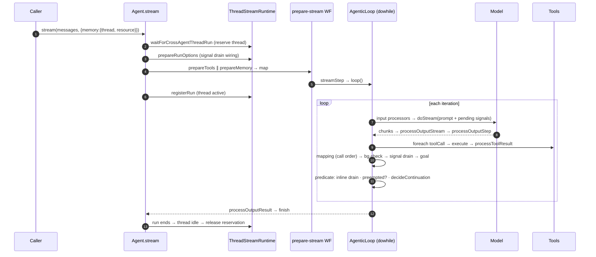

<script setup>
const B = 'https://github.com/mastra-ai/mastra/blob/ebe143c4916cf20b671a84f942d65d5df469f6cd/packages/core/src'
const outcomes = [
  'Trace a run from <code>agent.stream()</code> to <code>finish</code> and name every hook, in order',
  'Explain why Mastra builds its loop as a <code>dowhile</code> <em>workflow</em> instead of a <code>for</code> loop',
  'Predict what happens when two callers hit the same thread',
  'Stop a runaway loop with <code>stopWhen</code> and fix a lost update from parallel tools',
  'Pick the agent loop, a workflow, the AI SDK or LangGraph for a given job',
]
const iteration = [
  { name: 'llmExecutionStep', short: 'build the request, call the model', detail: 'Input-step processors, then `processLLMRequest`, then the model `doStream`, with `processOutputStream` on every chunk, then `processLLMResponse` and `processOutputStep`. Pending signals join the request here, and a request that has streamed **only reasoning** can be aborted when a signal is queued.', href: B + '/loop/workflows/agentic-execution/llm-execution-step.ts#L1488' },
  { name: 'map tool calls', short: 'split the turn into calls', detail: "Turns the model's tool calls into a list so the next step can `foreach` over them.", href: B + '/loop/loop-builder.ts#L263' },
  { name: 'foreach(toolCallStep)', short: 'run each tool', detail: 'Approval and suspend (human in the loop), `tool.execute`, `processToolResult`, background-task dispatch. Up to **10 at once** by default. Forced to 1 when approval-capable tools are present.', href: B + '/loop/workflows/agentic-execution/tool-call-concurrency.ts' },
  { name: 'llmMappingStep', short: 'fold results back', detail: 'Writes tool results into the `MessageList` **in call order** (not completion order) and emits `tool-result` chunks. This is why the next prompt is deterministic.', href: B + '/loop/workflows/agentic-execution/llm-mapping-step.ts' },
  { name: 'backgroundTaskCheckStep', short: 'collect finished bg tasks', detail: 'Injects results from background tasks that finished since the last step.', href: B + '/loop/workflows/agentic-execution/background-task-check-step.ts' },
  { name: 'signalDrainStep', short: 'let the mail in', detail: 'Drains queued signals into the transcript at a safe point: seal the current message, add the signal, mark the iteration as continued. All of Module 6 hangs off this step.', href: B + '/loop/loop-builder.ts#L206' },
  { name: 'isTaskComplete / goal', short: 'are we done yet?', detail: 'Completion scorers and goal evaluation. Then the `dowhile` predicate decides whether to go round again.', href: B + '/loop/workflows/agentic-execution/is-task-complete-step.ts' },
]
const hookOrder = [
  '`processInput` (once)',
  '`processInputStep` (step 0)',
  '`processOutputStep` sees the tool call',
  '`tool.execute` runs `check_ci`',
  '`onIterationComplete` (isFinal = false)',
  '`processInputStep` (step 1)',
  '`processOutputResult` (once)',
]
const recall = [
  { q: 'What shape is Mastra\'s agent loop?', a: 'A `dowhile` workflow: `createWorkflow(...).dowhile(iterationWorkflow, continuationPredicate)`. Each phase of an iteration is a workflow step.' },
  { q: 'Why a workflow instead of a `for` loop?', a: 'Steps have serializable inputs/outputs, their own spans, and a checkpoint boundary. The durable agent re-implements the same steps over serializable state.' },
  { q: 'Does `processOutputStep` run before or after the tools?', a: '**Before.** It sees the turn\'s tool calls and can veto them before any side effect.' },
  { q: 'Two `stream()` calls on the same thread, 10 ms apart. What happens?', a: 'The second waits for the first (thread reservation), then runs with the first exchange in its prompt. Per process unless you use a distributed PubSub.' },
  { q: 'What does the loop guarantee about parallel tool calls?', a: 'Results fold back in **call order**. It does **not** isolate their effects: up to 10 run concurrently by default.' },
  { q: '`maxSteps` vs `stopWhen`?', a: '`maxSteps` is a budget (caps damage). `stopWhen` is a policy (decides you are done or stuck). You usually want both.' },
]
const cheat = [
  { title: 'The shape', color: 'violet', lines: ['Loop = dowhile(iterationWorkflow, predicate)', 'Each phase is a workflow step: span, serializable I/O, checkpoint boundary', 'Durable agents reuse the same steps'] },
  { title: 'One iteration', color: 'amber', lines: ['LLM execution → map calls → foreach tools → mapping (call order) → bg tasks → signal drain → goal', 'Then the predicate: drain again, preempted?, decideContinuation'] },
  { title: 'Hook order', color: 'teal', lines: ['processInput once', 'per step: processInputStep → model → processOutputStep (BEFORE tools) → tools', 'processOutputResult once, then finish'] },
  { title: 'Concurrency', color: 'coral', lines: ['One run per thread (per process without distributed PubSub)', 'Up to 10 tool calls at once: order is guaranteed, isolation is not', 'toolCallConcurrency: 1, or make tools atomic'] },
  { title: 'Stopping', color: 'sky', lines: ['maxSteps = budget, stopWhen = policy', 'Preempted requests do not spend a step', 'Always-on agents need explicit stopWhen'] },
  { title: 'Choose', color: 'lime', lines: ['Model picks the tools → agent loop', 'Control flow known up front → workflow', 'Custom agent graph → workflow or LangGraph', 'One call in a script → AI SDK'] },
]
const choose = [
  { when: 'A model decides which tools to call, inside a conversation thread', not: 'The control flow is known in advance', alt: 'A Mastra workflow (`.then/.branch/.foreach`), or plain code' },
  { when: 'You need streaming, memory, processors and signals together', not: 'You only need one LLM call with tools in a script', alt: 'AI SDK `generateText` + `stopWhen`' },
  { when: 'Many callers share threads and you need one run per thread', not: 'You need a custom topology (planner → executor → critic)', alt: 'LangGraph, or a Mastra workflow with agent steps' },
  { when: 'You want the same loop to become durable later', not: 'Every step must be durable today, at any scale', alt: 'Temporal / Restate / Inngest, plus Mastra durable agents (Module 7)' },
]
const q_why_workflow = [
  { text: 'Streaming tokens to the client', why: 'A plain loop can stream just fine. Your Module 1 loop could.' },
  { text: 'Offering hooks at every phase', why: 'Hooks are function calls. A `for` loop can call them too.' },
  { text: 'Being rebuildable from serializable state so it can be checkpointed', correct: true, why: 'A step has a serializable input and output and a boundary where a durable engine can save progress.' },
  { text: 'Serving many callers at once', why: 'That one is solved by thread reservation, not by the loop shape.' },
]
const q_same_thread = [
  { text: 'Just `system` + `user: second`. Runs are independent.', why: 'They would be on different threads. On the same thread, run 2 waits and loads memory after run 1 saved it.' },
  { text: '`system`, `user: first`, `assistant: answer 1`, `user: second`', correct: true, why: 'Run 2 waited for the reservation, then loaded the thread history, including run 1.' },
  { text: 'An error: the thread is busy', why: 'Mastra queues the second run instead of rejecting it.' },
  { text: 'Half of answer 1, because both runs stream into one transcript', why: 'That is exactly the race thread reservation prevents.' },
]
const q_deploy_twice = [
  { text: 'A `stopWhen` condition', why: '`stopWhen` runs after the iteration, after the tool already ran. Too late: the second deploy happened.' },
  { text: 'A processor using `processOutputStep`', correct: true, why: 'It sees tool calls before execution, can drop or tripwire the second `deploy`, keeps per-run `state`, and works for every agent without touching the tool.' },
  { text: 'Inside the `deploy` tool itself', why: 'It works, but it couples policy to the tool and needs per-run state the tool does not naturally have. Close, but not the best fit.' },
  { text: 'Lower `maxSteps`', why: 'A budget is not a policy. The model could still deploy twice in one step.' },
]
const q_pick_tool = [
  { text: 'One Mastra agent with a long system prompt', why: 'You would be asking the model to simulate a topology you already know. Encode it instead.' },
  { text: 'A Mastra workflow with agent steps (or LangGraph)', correct: true, why: 'The control flow is known in advance. Make it explicit, and let each node be an agent.' },
  { text: 'AI SDK `generateText` with `stopWhen`', why: 'Great for one tool-using call. It has no topology, memory or threads.' },
]
const out1 = ' 1 processInput (once) msgs=1\n 2 processInputStep step=0 msgs=1\n 3 processOutputStep step=0 finish=tool-calls toolCalls=1\n 4 tool.execute check_ci(pr=42)\n 5 chunk tool-result\n 6 onIterationComplete iteration=1 isFinal=false\n 7 onStepFinish finishReason=tool-calls\n 8 chunk step-finish\n 9 processInputStep step=1 msgs=2\n10 processOutputStep step=1 finish=stop toolCalls=0\n11 onIterationComplete iteration=2 isFinal=true\n12 onStepFinish finishReason=stop\n13 chunk step-finish\n14 processOutputResult (once) msgs=1\n15 chunk finish'
const out2 = '=== Same thread: serialized ===\n  first started\n  first finished: answer 1\n  second started\n  second finished: answer 2\n  request #2: system Be brief. / user first / assistant answer 1 / user second\n\n=== Different threads: concurrent ===\n  first started\n  second started'
</script>

# Module 2: The agent loop

<p class="lead">You type one line: <code>agent.stream('…')</code>. Between that and the <code>finish</code> chunk, fifteen things happen in a precise order. By the end of this lesson you'll be able to recite them, and you'll know which ones bite.</p>

<LessonHero module="02" :minutes="40" lab="Lab runs in ~3 s, no API keys" :outcomes="outcomes" mood="alarmed">

**Launch day, 9:02 am.** Your booking agent tells a customer *"Done! Both seats are booked."* The database says one seat. Down the hall, your CI agent has called `search('flaky')` thirty times in a row and billed you for every one.

Nobody touched Mastra's code. Both bugs live inside a loop you've never looked at. Let's look at it.

</LessonHero>

<Journey :station="1" module="02" />

## The problem {#problem}

In Module 1 you wrote an agent loop in about 190 lines. It works great for **one caller, in one process, on a good day**.

A framework loop has a longer to-do list. It has to:

- **stream** every token and tool event to clients, in order;
- serve **many callers at once** without two runs scribbling on one conversation;
- load **memory** before the first request and save the transcript after;
- offer **hooks** at every phase, so nobody has to fork the loop;
- accept **signals** while it's running;
- be rebuildable from **serializable state**, so a durable engine can checkpoint it.

That last line is the one that shapes everything else.

<Callout type="analogy" title="A recipe in your head vs a recipe card">

A `for` loop is a recipe you keep in your head. Fast, but if you faint mid-souffle, nobody knows where you were.

A workflow is the same recipe written on a card, with a tick next to each finished step. Anyone can pick it up. An inspector can see exactly which step you're on. That's what Mastra wants for its loop.

</Callout>

<Quiz module="02" id="why-workflow" question="Which requirement forces Mastra to build its loop out of workflow steps instead of a plain `while` loop?" :options="q_why_workflow" explain="Bonus: every step also gets its own tracing span, so observability comes for free." />

<StationDone module="02" :station="1" />

<Journey :station="2" module="02" />

## Under the hood {#under-the-hood}

Enough talk. Here is one real run, the exact one Lab 2 checks against the published package. Press **Next** (or use your arrow keys) and watch the message list grow.

<LoopVisualizer />

Try the other two scenarios too. **Two tools at once** and **Runaway loop** are the two bugs from launch day, and you'll fix both in Station 3.

### The loop is a workflow

Strip away the options, and [`AgenticLoopBuilder.build()`](https://github.com/mastra-ai/mastra/blob/ebe143c4916cf20b671a84f942d65d5df469f6cd/packages/core/src/loop/loop-builder.ts#L687) returns this:

```ts
createWorkflow({ id: 'agentic-loop', ... })
  .dowhile(iterationWorkflow, continuationPredicate)
  .commit();
```

That's it. The body of the loop is *another* workflow, and each phase is a step. Click through the seven stations of one lap:

<ClickMap title="One iteration, seven steps" :stations="iteration" start-label="step starts" end-label="predicate" loop />

<Misconception myth="processOutputStep runs after the tools, so it can see their results.">

It runs **before** them. `processOutputStep` sees the model's finished turn, including its tool calls, while nothing has happened yet in the outside world. That makes it the perfect place to say "no, you may not call `deploy` twice". Tool results get their own hook, `processToolResult`.

</Misconception>

Now prove it to yourself. Here's the run you just watched, scrambled:

<OrderSteps module="02" id="hook-order" prompt="Put these in the order they fire for &quot;one tool call, then an answer&quot;." :items="hookOrder" explain="The full lab trace has 15 lines, with chunks like `tool-result` and `step-finish` mixed in. This is its skeleton." />

### The stop check

After every lap, the `dowhile` predicate decides whether to go round again. It checks, in order:

1. Resume bookkeeping (a resumed run continues the right message).
2. **One more signal drain**, for mail that arrived after step 6.
3. **Was this request preempted by a signal?** Then loop again *without spending a step*.
4. [`decideContinuation`](https://github.com/mastra-ai/mastra/blob/ebe143c4916cf20b671a84f942d65d5df469f6cd/packages/core/src/loop/shared/continuation-core.ts#L115): `stopWhen`, `maxSteps`, `onIterationComplete` and friends.
5. Emit `step-finish`, handle tripwires and aborts.

<MascotSays mood="thinking">

My favourite comment in the codebase lives next to item 3: *"a signal replaces the physical request, not the logical step or its budget."* Remember it. It comes back in Station 3.

</MascotSays>

### Before the first lap: the thread lane

Before the loop even starts, `Agent.stream()` **reserves the thread**. Two calls on the same `(resource, thread)` don't race. The second one waits in line.

<ThreadLanes />

<Quiz kind="predict" module="02" id="same-thread" question="Two `stream()` calls hit the same thread 10 ms apart. The model takes 300 ms. What does the **second** run's prompt contain?" :options="q_same_thread">

```ts
const a = agent.stream('first',  { memory: { thread: 't1', resource: 'u1' } });
await sleep(10);
const b = agent.stream('second', { memory: { thread: 't1', resource: 'u1' } });
```

</Quiz>

See both for real. The lab prints every hook and every prompt:

<TryIt cmd="npm run lab:anatomy" :output="out1">

Real `@mastra/core@1.75.0`, mock model. The test pins this exact order, so a release that reorders hooks fails CI.

</TryIt>

<TryIt cmd="npm run lab:thread-reservation" :output="out2" />

<DeepDive title="Agent.stream(), the prepare-stream workflow and the full sequence">

What [`Agent.stream()`](https://github.com/mastra-ai/mastra/blob/ebe143c4916cf20b671a84f942d65d5df469f6cd/packages/core/src/agent/agent.ts#L9581) does before the first lap:

1. Durable agents take the durable path (Module 7).
2. Merge default and call options. `untilIdle` wraps everything in an outer stream that re-enters on background-task completion or signals.
3. Resolve the model (v2/v3 specs; v1 goes to `streamLegacy`).
4. Assign a `runId`, then [`waitForCrossAgentThreadRun`](https://github.com/mastra-ai/mastra/blob/ebe143c4916cf20b671a84f942d65d5df469f6cd/packages/core/src/agent/agent.ts#L9692) reserves the thread ([runtime L4128](https://github.com/mastra-ai/mastra/blob/ebe143c4916cf20b671a84f942d65d5df469f6cd/packages/core/src/agent/thread-stream-runtime.ts#L4128)).
5. [`prepareRunOptions`](https://github.com/mastra-ai/mastra/blob/ebe143c4916cf20b671a84f942d65d5df469f6cd/packages/core/src/agent/agent.ts#L9698) wires `drainPendingSignals` / `subscribePendingSignals`.
6. `#execute` builds the [prepare-stream workflow](https://github.com/mastra-ai/mastra/blob/ebe143c4916cf20b671a84f942d65d5df469f6cd/packages/core/src/agent/workflows/prepare-stream/index.ts#L230): `parallel([prepareToolsStep, prepareMemoryStep]) → mapResultsStep → streamStep`, and `streamStep` calls `loop()`.
7. [`registerRun`](https://github.com/mastra-ai/mastra/blob/ebe143c4916cf20b671a84f942d65d5df469f6cd/packages/core/src/agent/agent.ts#L9744) makes the run the thread's active run. On error, the reservation is released.



**The predicate:** [`loop-builder.ts#L419`](https://github.com/mastra-ai/mastra/blob/ebe143c4916cf20b671a84f942d65d5df469f6cd/packages/core/src/loop/loop-builder.ts#L419), `signalPreempted` at [L499](https://github.com/mastra-ai/mastra/blob/ebe143c4916cf20b671a84f942d65d5df469f6cd/packages/core/src/loop/loop-builder.ts#L499).

**Tests worth reading:**

- [`stream-signals.test.ts`](https://github.com/mastra-ai/mastra/blob/ebe143c4916cf20b671a84f942d65d5df469f6cd/packages/core/src/loop/workflows/stream-signals.test.ts): how signals join requests.
- [`tool-call-concurrency.test.ts`](https://github.com/mastra-ai/mastra/blob/ebe143c4916cf20b671a84f942d65d5df469f6cd/packages/core/src/loop/workflows/agentic-execution/tool-call-concurrency.test.ts): the concurrency strategies.
- [`llm-execution-step.test.ts`](https://github.com/mastra-ai/mastra/blob/ebe143c4916cf20b671a84f942d65d5df469f6cd/packages/core/src/loop/workflows/agentic-execution/llm-execution-step.test.ts): request building and interruption ([L1299](https://github.com/mastra-ai/mastra/blob/ebe143c4916cf20b671a84f942d65d5df469f6cd/packages/core/src/loop/workflows/agentic-execution/llm-execution-step.ts#L1299)).
- [`continuation-core.ts`](https://github.com/mastra-ai/mastra/blob/ebe143c4916cf20b671a84f942d65d5df469f6cd/packages/core/src/loop/shared/continuation-core.ts): why the durable and default engines share one decision function.

</DeepDive>

<StationDone module="02" :station="2" />

<Journey :station="3" module="02" />

## Break it {#break-it}

Time to recreate launch day on purpose. Both bugs sit right on the edge of what the loop promises.

### Bug 1: the runaway agent

The model calls `search({ q: 'flaky' })` every single step. `maxSteps: 30` caps the damage at 30 calls. It doesn't *notice* anything is wrong.

<LoopVisualizer initial="runaway" />

<Callout type="tip" title="Your mission (Exercise 2.1)">

Write `stopOnRepeat(n)`, a real Mastra `stopWhen` condition that stops after `n` identical tool calls. The test wants 3 executions, not 30. Hint: the tool name and args live inside `payload` on Mastra's step chunks.

</Callout>

### Bug 2: two tools, one lost booking

The model books two seats **in one turn**. The tool does read, then `await`, then write. Flip the toggle and compare.

<LoopVisualizer initial="parallel" />

<Callout type="tip" title="Your mission (Exercise 2.2)">

Make the test see `seats_left = 8` without changing the model script. There are **two** valid fixes. One is a single option on the call. The other is better, because it protects the tool no matter who calls it.

</Callout>

<TryIt cmd="LAB_TARGET=exercises node --import tsx --test m02-agent-loop/break-it.test.ts">

Both tests fail on the starter code. Your job is to make them pass. Solutions and walkthroughs are on the [Break it page](./break-it).

</TryIt>

### Three more sharp edges

<Misconception myth="If a signal arrives while my 10-minute tool runs, the agent sees it right away.">

Signals are **cooperative, not preemptive**. Only a request that has streamed *nothing but reasoning* can be interrupted. A signal sent during a 10-minute tool waits 10 minutes, then gets drained at the next safe point.

</Misconception>

<Misconception myth="maxSteps: 50 means the agent makes at most 50 model calls.">

A request preempted by a signal **doesn't spend a step** (that comment from Station 2). A steady drip of signals can keep an always-on agent looping. Give it an explicit `stopWhen` policy and rate-limit your signal sources.

</Misconception>

<Misconception myth="Thread reservation means one run per thread across all my servers.">

It's **per process**, unless you configure a distributed PubSub (Module 6). Two server instances can each run "the only" run on a thread.

</Misconception>

<Quiz module="02" id="deploy-twice" question="You want to guarantee &quot;never call `deploy` twice in one run&quot;. Where does that rule belong?" :options="q_deploy_twice" explain="This is the course's house rule in action: if it can be a processor, make it a processor. That's Module 3." />

<StationDone module="02" :station="3" />

<Journey :station="4" module="02" />

## Choose wisely {#choose-wisely}

Mastra's loop is a fixed shape that you **hook** (processors) and **configure** (`stopWhen`, `toolCallConcurrency`, `maxSteps`). You don't rewire it.

<Callout type="analogy" title="Train set vs finished railway">

LangGraph hands you track pieces: an `agent` node, a `tools` node, a conditional edge, a checkpointer after every super-step. Build any layout you like.

Mastra hands you one well-tested railway with lots of switches and signal boxes already wired: streaming, threads, memory and signals included. If your "agent" is really a custom state machine, don't fight the railway. Lay track with a workflow (Module 5) or LangGraph.

</Callout>

<Choose subject="the agent loop" :rows="choose" />

<Quiz module="02" id="pick-tool" question="Your design has a planner, an executor and a critic, with an edge from critic back to planner after a failed review. What do you reach for?" :options="q_pick_tool" />

<StationDone module="02" :station="4" next="./lab" next-label="On to the lab" />

## Wrap-up

<Podcast title="The agent loop, in five minutes" :minutes="5">

**Host:** So I call `agent.stream()` and text comes back. What's actually happening?

**Loopy:** A loop! Ask the model, run whatever tools it asks for, fold the results back, ask again. It stops when the model answers without asking for a tool.

**Host:** That's the loop we wrote by hand in Module 1. What's different in Mastra?

**Loopy:** The shape. Mastra's loop is a workflow: a `dowhile` around another workflow. Each phase is a step. Model call, tool calls, folding results back, checking for signals, checking goals.

**Host:** Why go to the trouble?

**Loopy:** Because a step has a serializable input and output, its own trace span, and a boundary where you can save progress. That's what lets the durable agent in Module 7 run the same loop and survive a crash.

**Host:** Where can I plug in my own code?

**Loopy:** Processors, at every phase. `processInput` runs once at the start. `processInputStep` runs before every model call. `processOutputStep` runs after the model answers but **before** any tool runs, so it can veto a dangerous call. And `processOutputResult` runs once at the end.

**Host:** What if two people message the same conversation at once?

**Loopy:** The second waits. Mastra reserves the thread, so there's one run per thread. When the second run starts, it sees the first exchange in its history. Careful though: that's per process unless you set up a distributed PubSub.

**Host:** And the launch-day bugs?

**Loopy:** Two of them. First, the runaway agent. `maxSteps` is a budget, not a policy. If you want to stop when the model is stuck, write a `stopWhen` condition. Second, parallel tools. Mastra runs up to ten tool calls at once and folds their results back in call order. Order is guaranteed. Isolation isn't. If two calls read and write the same row, you lose an update. Fix it with `toolCallConcurrency: 1`, or better, make the tool atomic.

**Host:** When should I not use the agent loop?

**Loopy:** When you already know the control flow. Then write a workflow. When you need one model call in a script, use the AI SDK. And when you need a custom graph of agents, use a workflow with agent steps, or LangGraph.

</Podcast>

<Recall module="02" :cards="recall" />

<CheatCard module="02" title="The agent loop" subtitle="agent.stream() → finish, in one page" :cells="cheat" />

<Callout type="win" title="Where next">

- **[Lab 2](./lab):** run the anatomy and reservation labs, then go hook hunting.
- **[Break it](./break-it):** the two exercises, with full solutions.
- **[Check your understanding](./quiz):** seven questions, including a design question.
- **[Module 3: Processors](/m03/):** the extension point you just met five times.

</Callout>
