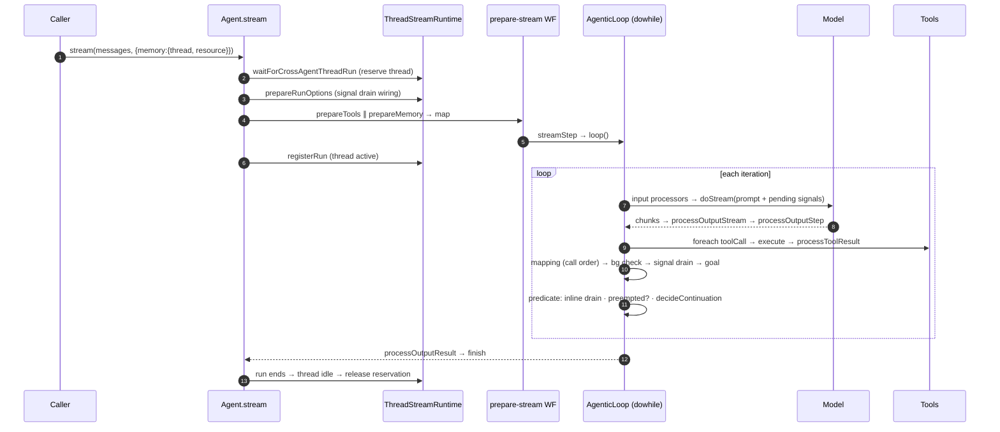

# Module 2: The agent loop

**Goal:** know exactly what happens between `agent.stream('…')` and the `finish` chunk: thread reservation, the prepare-stream workflow, the iteration workflow and its seven steps, the continuation predicate, and tool-call fan-out/fold-back. Then break it twice.

**Lab:** [`labs/m02-agent-loop`](https://github.com/rphansen91/mastra-primitives-course/tree/main/labs/m02-agent-loop) · [Lab guide](./lab) · [Break it](./break-it) · [Quiz](./quiz)

## Pass 1: the problem

Your Module 1 loop works for one caller in one process. A framework loop also has to:

- **stream** every token and tool event to clients, in order, with step boundaries;
- serve **many concurrent callers** without two runs corrupting one conversation;
- load **memory** before the first request and persist the transcript after;
- expose **hooks** at every phase without forking the loop;
- accept **signals** mid-run;
- be **re-implementable over serializable state** so a durable engine can checkpoint it.

The last requirement drives Mastra's central design decision.

## Pass 2: how it's built

### The loop is a workflow

[`AgenticLoopBuilder.build()`](https://github.com/mastra-ai/mastra/blob/ebe143c4916cf20b671a84f942d65d5df469f6cd/packages/core/src/loop/loop-builder.ts#L687) returns, in essence:

```ts
createWorkflow({ id: 'agentic-loop', ... })
  .dowhile(iterationWorkflow, continuationPredicate)
  .commit();
```

The loop body is itself a workflow ([`buildIterationWorkflow`](https://github.com/mastra-ai/mastra/blob/ebe143c4916cf20b671a84f942d65d5df469f6cd/packages/core/src/loop/loop-builder.ts#L263)), and each phase is a workflow **step**:

| # | Step | Source | What it does |
|---|---|---|---|
| ① | `llmExecutionStep` | [`llm-execution-step.ts`](https://github.com/mastra-ai/mastra/blob/ebe143c4916cf20b671a84f942d65d5df469f6cd/packages/core/src/loop/workflows/agentic-execution/llm-execution-step.ts) | input-step processors → `processLLMRequest` → model `doStream` → `processOutputStream` per chunk → `processLLMResponse` / `processOutputStep`. Joins pending signals into the request ([L1488](https://github.com/mastra-ai/mastra/blob/ebe143c4916cf20b671a84f942d65d5df469f6cd/packages/core/src/loop/workflows/agentic-execution/llm-execution-step.ts#L1488)); can abort a reasoning-only request when a signal is queued ([L1299-1309](https://github.com/mastra-ai/mastra/blob/ebe143c4916cf20b671a84f942d65d5df469f6cd/packages/core/src/loop/workflows/agentic-execution/llm-execution-step.ts#L1299)). |
| ② | map tool calls | [`loop-builder.ts`](https://github.com/mastra-ai/mastra/blob/ebe143c4916cf20b671a84f942d65d5df469f6cd/packages/core/src/loop/loop-builder.ts#L263) | splits the turn's tool calls into a list for `foreach` |
| ③ | `foreach(toolCallStep)` | [`tool-call-step.ts`](https://github.com/mastra-ai/mastra/blob/ebe143c4916cf20b671a84f942d65d5df469f6cd/packages/core/src/loop/workflows/agentic-execution/tool-call-step.ts), [`tool-call-concurrency.ts`](https://github.com/mastra-ai/mastra/blob/ebe143c4916cf20b671a84f942d65d5df469f6cd/packages/core/src/loop/workflows/agentic-execution/tool-call-concurrency.ts) | approval / suspend (human-in-the-loop), `tool.execute`, `processToolResult`, background-task dispatch. Concurrency limit 10 by default; forced to 1 when approval-capable tools are present (strategy `available`). |
| ④ | `llmMappingStep` | [`llm-mapping-step.ts`](https://github.com/mastra-ai/mastra/blob/ebe143c4916cf20b671a84f942d65d5df469f6cd/packages/core/src/loop/workflows/agentic-execution/llm-mapping-step.ts) | writes tool results into the `MessageList` **in call order**, emits `tool-result` chunks |
| ⑤ | `backgroundTaskCheckStep` | [`background-task-check-step.ts`](https://github.com/mastra-ai/mastra/blob/ebe143c4916cf20b671a84f942d65d5df469f6cd/packages/core/src/loop/workflows/agentic-execution/background-task-check-step.ts) | injects finished background-task results |
| ⑥ | `signalDrainStep` | [`loop-builder.ts#L206`](https://github.com/mastra-ai/mastra/blob/ebe143c4916cf20b671a84f942d65d5df469f6cd/packages/core/src/loop/loop-builder.ts#L206), [`signal-drain-core.ts`](https://github.com/mastra-ai/mastra/blob/ebe143c4916cf20b671a84f942d65d5df469f6cd/packages/core/src/loop/shared/steps/signal-drain-core.ts#L35) | drains queued signals into the transcript (Module 6) |
| ⑦ | `isTaskCompleteStep` / `goalStep` | [`is-task-complete-step.ts`](https://github.com/mastra-ai/mastra/blob/ebe143c4916cf20b671a84f942d65d5df469f6cd/packages/core/src/loop/workflows/agentic-execution/is-task-complete-step.ts), [`goal-step.ts`](https://github.com/mastra-ai/mastra/blob/ebe143c4916cf20b671a84f942d65d5df469f6cd/packages/core/src/loop/workflows/agentic-execution/goal-step.ts) | completion scorers and goal evaluation |

Why a workflow and not a `for` loop? Because a workflow step has a serializable input and output, a span, and a place for a durable engine to checkpoint. The durable agent ([Module 7](/m07/)) re-implements **the same steps** over serializable state. That's the house rule *"everything durable or observable is a step"* applied to the framework's own core.

### The continuation predicate

After each iteration, the [`dowhile` predicate](https://github.com/mastra-ai/mastra/blob/ebe143c4916cf20b671a84f942d65d5df469f6cd/packages/core/src/loop/loop-builder.ts#L419) decides whether to go again, in this order:

1. resume seal-and-rotate (a resumed run continues the right message);
2. **a second inline signal drain**, for signals that arrived after step ⑥;
3. **`signalPreempted`** ([L499](https://github.com/mastra-ai/mastra/blob/ebe143c4916cf20b671a84f942d65d5df469f6cd/packages/core/src/loop/loop-builder.ts#L499)): if a signal interrupted the request, loop again *without spending a step*. The code comment says it well: "a signal replaces the physical request, not the logical step or its budget";
4. [`decideContinuation`](https://github.com/mastra-ai/mastra/blob/ebe143c4916cf20b671a84f942d65d5df469f6cd/packages/core/src/loop/shared/continuation-core.ts#L115): `stopWhen`, `maxSteps`, feedback stops, delegation bail, `onIterationComplete`;
5. emit `step-finish`; handle tripwire and abort.

### Before the loop: `Agent.stream()` and the prepare-stream workflow

[`Agent.stream()`](https://github.com/mastra-ai/mastra/blob/ebe143c4916cf20b671a84f942d65d5df469f6cd/packages/core/src/agent/agent.ts#L9581):

1. Durable agents take the durable path.
2. Merge default options with call options. `untilIdle` wraps everything in an outer stream that re-enters on background-task completion or signals.
3. Resolve the model (v2/v3 specs; v1 goes to `streamLegacy`).
4. Assign a `runId`, then [`waitForCrossAgentThreadRun`](https://github.com/mastra-ai/mastra/blob/ebe143c4916cf20b671a84f942d65d5df469f6cd/packages/core/src/agent/agent.ts#L9692) **reserves the thread** ([runtime L4128](https://github.com/mastra-ai/mastra/blob/ebe143c4916cf20b671a84f942d65d5df469f6cd/packages/core/src/agent/thread-stream-runtime.ts#L4128)): concurrent `stream()` calls on one `(resource, thread)` run one after another.
5. [`prepareRunOptions`](https://github.com/mastra-ai/mastra/blob/ebe143c4916cf20b671a84f942d65d5df469f6cd/packages/core/src/agent/agent.ts#L9698) wires `drainPendingSignals` / `subscribePendingSignals` for this run.
6. `#execute` builds the [prepare-stream workflow](https://github.com/mastra-ai/mastra/blob/ebe143c4916cf20b671a84f942d65d5df469f6cd/packages/core/src/agent/workflows/prepare-stream/index.ts#L230): `parallel([prepareToolsStep, prepareMemoryStep]) → mapResultsStep → streamStep`, and `streamStep` calls `loop()`.
7. [`registerRun`](https://github.com/mastra-ai/mastra/blob/ebe143c4916cf20b671a84f942d65d5df469f6cd/packages/core/src/agent/agent.ts#L9744) makes the run visible as the thread's active run and fans chunks out to thread subscribers. On error, the reservation is released.



### The observable result

The lab prints the exact hook and chunk order for "one tool call, then an answer". This is verified behavior on `@mastra/core@1.75.0`, not a reading of the docs:

```text
 1 processInput (once) msgs=1
 2 processInputStep step=0 msgs=1
 3 processOutputStep step=0 finish=tool-calls toolCalls=1
 4 tool.execute check_ci(pr=42)
 5 chunk tool-result
 6 onIterationComplete iteration=1 isFinal=false
 7 onStepFinish finishReason=tool-calls
 8 chunk step-finish
 9 processInputStep step=1 msgs=2
10 processOutputStep step=1 finish=stop toolCalls=0
11 onIterationComplete iteration=2 isFinal=true
12 onStepFinish finishReason=stop
13 chunk step-finish
14 processOutputResult (once) msgs=1
15 chunk finish
```

Note `processOutputStep` runs **before** the tool executes. It sees the model's tool calls and can veto them.

## Pass 3: where it breaks

The [break-it exercises](./break-it) target two boundaries of the loop's guarantees:

1. **Runaway loops.** `maxSteps` caps the damage but doesn't diagnose it; you'll write a `stopWhen` loop detector over Mastra's step history.
2. **Parallel tool calls.** The loop folds results deterministically, but it runs tools **concurrently** (limit 10). A read-modify-write tool loses updates. The loop guarantees result *order*, not tool *isolation*.

Other sharp edges worth knowing:

- **Signals don't preempt tools.** Only a request that has streamed *nothing but reasoning* can be interrupted. A signal sent during a 10-minute tool waits 10 minutes.
- **A steady stream of signals can keep a run looping.** Preempted requests don't consume `maxSteps`. Set `stopWhen` deliberately for always-on agents.
- **The thread reservation is per process** unless you configure a distributed PubSub (Module 6). Two server instances can each run "the only" run on a thread.
- **`agent.ts` and the loop are critical paths.** External PRs touching `loop.ts` are auto-closed (see `CRITICAL_PATHS.md`). New behavior belongs in a processor (Module 3).

## Pass 4: when to choose something else

### Compare: LangGraph's agent

LangGraph models the agent as an explicit graph (`agent` node ↔ `tools` node, conditional edge on "has tool calls"), with state in a typed channel and a checkpointer saving state after every super-step. Mastra's loop is the same `dowhile` shape, but fixed: you don't rewire the nodes, you hook them (processors) and configure them (`stopWhen`, `toolCallConcurrency`, `maxSteps`). LangGraph gives you more control over topology; Mastra gives you a single well-tested loop with a richer hook surface, streaming, threads and signals built in. If your "agent" is really a custom state machine, write a Mastra **workflow** (Module 5) or use LangGraph; don't fight the loop.

### Decision table

| Use the Mastra agent loop when | Don't when | Alternatives |
|---|---|---|
| A model decides which tools to call, in a conversation thread | The control flow is known in advance | Mastra workflow (`.then/.branch/.foreach`); plain code |
| You need streaming, memory, processors and signals together | You only need one LLM call with tools in a script | AI SDK `generateText` + `stopWhen` |
| Many callers share threads and you need one run per thread | You need custom agent topology (planner/executor graphs) | LangGraph; Mastra workflow with agent steps |
| You want the same loop to become durable later | You need every step durable today, at any scale | Temporal / Restate / Inngest (`createInngestAgent`) + Mastra durable agents (Module 7) |

## Read the source and tests

- [`stream-signals.test.ts`](https://github.com/mastra-ai/mastra/blob/ebe143c4916cf20b671a84f942d65d5df469f6cd/packages/core/src/loop/workflows/stream-signals.test.ts): how signals join requests.
- [`tool-call-concurrency.test.ts`](https://github.com/mastra-ai/mastra/blob/ebe143c4916cf20b671a84f942d65d5df469f6cd/packages/core/src/loop/workflows/agentic-execution/tool-call-concurrency.test.ts): the concurrency strategies.
- [`llm-execution-step.test.ts`](https://github.com/mastra-ai/mastra/blob/ebe143c4916cf20b671a84f942d65d5df469f6cd/packages/core/src/loop/workflows/agentic-execution/llm-execution-step.test.ts): request building and interruption.
- [`continuation-core.ts`](https://github.com/mastra-ai/mastra/blob/ebe143c4916cf20b671a84f942d65d5df469f6cd/packages/core/src/loop/shared/continuation-core.ts): why durable and default engines share a decision function.
