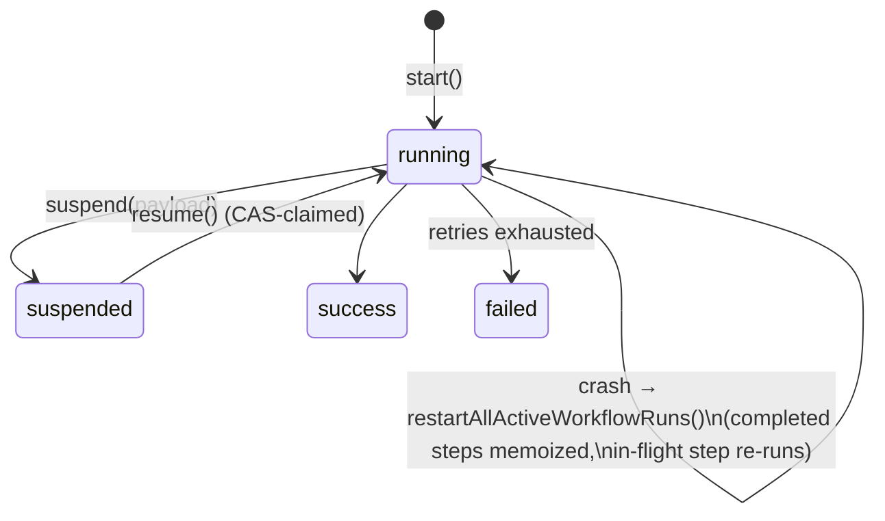

# Module 5: Workflows

**Goal:** understand Mastra workflows as the substrate everything else is built on: the step graph, run state and snapshots, suspend/resume, sleep, retries, and "loop-as-workflow". Know exactly what a snapshot buys you and what it doesn't.

**Depth:** lesson + lab spec. Module 7's crash lab exercises workflow recovery for real.

## Pass 1: the problem

Some work has a known shape: fetch → validate → branch → fan out → wait for a human → finish. Writing it as nested `await`s works until you need to **pause for days** (approval), **observe** each step, **retry one step**, or **survive a restart**. Then you need the shape as data: a graph of steps with typed inputs and outputs, and persisted run state.

## Pass 2: how it's built

### The step graph

[`createWorkflow`](https://github.com/mastra-ai/mastra/blob/ebe143c4916cf20b671a84f942d65d5df469f6cd/packages/core/src/workflows/workflow.ts) returns a builder. Each method appends a node to a serializable step graph:

| Builder | Line | Meaning |
|---|---|---|
| `.then(step)` | [L2063](https://github.com/mastra-ai/mastra/blob/ebe143c4916cf20b671a84f942d65d5df469f6cd/packages/core/src/workflows/workflow.ts#L2063) | sequence |
| `.parallel([a, b])` | [L2546](https://github.com/mastra-ai/mastra/blob/ebe143c4916cf20b671a84f942d65d5df469f6cd/packages/core/src/workflows/workflow.ts#L2546) | fan out, join |
| `.branch([[cond, step], …])` | | conditional |
| `.foreach(step, { concurrency })` | | map over an array |
| `.dowhile(step, cond)` / `.dountil` | [L2670](https://github.com/mastra-ai/mastra/blob/ebe143c4916cf20b671a84f942d65d5df469f6cd/packages/core/src/workflows/workflow.ts#L2670) / [L2723](https://github.com/mastra-ai/mastra/blob/ebe143c4916cf20b671a84f942d65d5df469f6cd/packages/core/src/workflows/workflow.ts#L2723) | loops (the agent loop uses `dowhile`) |
| `.map(fn)` | [L2375](https://github.com/mastra-ai/mastra/blob/ebe143c4916cf20b671a84f942d65d5df469f6cd/packages/core/src/workflows/workflow.ts#L2375) | reshape data between steps |
| `.sleep(ms)` / `.sleepUntil(date)` | [L2264](https://github.com/mastra-ai/mastra/blob/ebe143c4916cf20b671a84f942d65d5df469f6cd/packages/core/src/workflows/workflow.ts#L2264) / [L2314](https://github.com/mastra-ai/mastra/blob/ebe143c4916cf20b671a84f942d65d5df469f6cd/packages/core/src/workflows/workflow.ts#L2314) | timers |
| `.waitForEvent(…)` | [L2360](https://github.com/mastra-ai/mastra/blob/ebe143c4916cf20b671a84f942d65d5df469f6cd/packages/core/src/workflows/workflow.ts#L2360) | **removed**: throws `WORKFLOW_WAIT_FOR_EVENT_REMOVED`, use suspend/resume |
| `.commit()` | [L2852](https://github.com/mastra-ai/mastra/blob/ebe143c4916cf20b671a84f942d65d5df469f6cd/packages/core/src/workflows/workflow.ts#L2852) | freeze the graph |

Steps (`createStep`) have `inputSchema`, `outputSchema`, optional `suspendSchema`/`resumeSchema`, `retries`, and an `execute` that receives `inputData`, `suspend`, `resumeData`, `state`, `requestContext`, and more. Agents and tools can be steps directly (`createStepFromAgent`, `createStepFromTool`).

### Runs, engines and snapshots

`workflow.createRun()` ([L2883](https://github.com/mastra-ai/mastra/blob/ebe143c4916cf20b671a84f942d65d5df469f6cd/packages/core/src/workflows/workflow.ts#L2883)) → `run.start()` ([L4212](https://github.com/mastra-ai/mastra/blob/ebe143c4916cf20b671a84f942d65d5df469f6cd/packages/core/src/workflows/workflow.ts#L4212)) executes on an **execution engine**:

- **Default engine** ([`default.ts`](https://github.com/mastra-ai/mastra/blob/ebe143c4916cf20b671a84f942d65d5df469f6cd/packages/core/src/workflows/default.ts)): in process. After every step, `persistStepUpdate` writes a **snapshot** (step results, execution path, suspended paths, serialized graph, retry counts, requestContext) to the `workflow_snapshots` table for `(workflowName, runId)`. `shouldPersistSnapshot` can thin writes ([entry.ts L195](https://github.com/mastra-ai/mastra/blob/ebe143c4916cf20b671a84f942d65d5df469f6cd/packages/core/src/workflows/handlers/entry.ts#L195)).
- **Evented engine** ([`workflows/evented/`](https://github.com/mastra-ai/mastra/tree/ebe143c4916cf20b671a84f942d65d5df469f6cd/packages/core/src/workflows/evented)): steps as PubSub events processed by workers; needs a store with atomic concurrent updates.
- **Inngest / Temporal** ([`workflows/inngest`](https://github.com/mastra-ai/mastra/tree/ebe143c4916cf20b671a84f942d65d5df469f6cd/workflows/inngest), [`workflows/temporal`](https://github.com/mastra-ai/mastra/tree/ebe143c4916cf20b671a84f942d65d5df469f6cd/workflows/temporal)): the same workflow definition runs on another platform. The seams are `wrapDurableOperation` ([L173](https://github.com/mastra-ai/mastra/blob/ebe143c4916cf20b671a84f942d65d5df469f6cd/packages/core/src/workflows/default.ts#L173), a no-op by default, `step.run` on Inngest) and `executeSleepDuration` ([L140](https://github.com/mastra-ai/mastra/blob/ebe143c4916cf20b671a84f942d65d5df469f6cd/packages/core/src/workflows/default.ts#L140), `setTimeout` by default).

### Suspend and resume

A step calls `suspend(payload)`; the run's status becomes `suspended` and the snapshot records the suspended path. Later, `run.resume({ step, resumeData })` ([L4781](https://github.com/mastra-ai/mastra/blob/ebe143c4916cf20b671a84f942d65d5df469f6cd/packages/core/src/workflows/workflow.ts#L4781)) continues from there, even in a different process. The resume is **CAS-claimed** ([`#claimResume` L4882](https://github.com/mastra-ai/mastra/blob/ebe143c4916cf20b671a84f942d65d5df469f6cd/packages/core/src/workflows/workflow.ts#L4882)): `suspended → running`, so two callers can't both resume. Tool approval in agents uses the same mechanism.

### Loop-as-workflow

The agent loop (Module 2) is `dowhile(iteration, predicate)`. The notification dispatcher (Module 6) is a cron workflow. Scheduled workflows, time travel ([L5648](https://github.com/mastra-ai/mastra/blob/ebe143c4916cf20b671a84f942d65d5df469f6cd/packages/core/src/workflows/workflow.ts#L5648)) and restart ([L4860](https://github.com/mastra-ai/mastra/blob/ebe143c4916cf20b671a84f942d65d5df469f6cd/packages/core/src/workflows/workflow.ts#L4860)) all operate on the same run state. The workflow is Mastra's universal "unit of observable, resumable work".

## Pass 3: where it falls down

These are verified in [Module 7's crash lab](/m07/lab) or read directly from source at the pinned commit:

- **The in-flight step always re-runs after a crash.** Snapshots are written *between* steps. A step that charged a card and then died charges again on restart. Make steps idempotent.
- **No ownership on restart.** `restartAllActiveWorkflowRuns()` has no claim or fence: a second replica booting while the first is alive **runs the in-flight step concurrently in both processes**. The crash lab shows `slow-step` and `final` executing in two pids. The docs tell you to disable `recovery.workflows` when replicas share a database.
- **Timers aren't durable on the default engine.** `sleep` is `setTimeout`; a restart during a 1-hour sleep restarts the sleep (or the step). The evented engine stores waiting steps and replays them.
- **`waitForEvent` is gone.** Correlated, timeout-bounded external events must be modeled with suspend/resume plus your own timeout.
- **Retries are fixed-delay, in memory.** No exponential backoff, jitter, schedule-to-close timeouts or heartbeats.
- **No versioning for in-flight code-defined workflows.** A restart replays against whatever code is deployed now.

## Pass 4: when to choose something else

| Use a Mastra workflow when | Don't when | Alternatives |
|---|---|---|
| The shape of the work is known: steps, branches, fan-out | The model should decide the next action | Agent loop (Module 2) |
| You need human-in-the-loop pauses (suspend/resume) | You need durable timers/events at scale on the default engine | Evented engine; Inngest/Temporal runners; Temporal/Restate directly |
| You want observability per step and time travel | Steps aren't idempotent and you run multiple replicas with auto-restart | Single-instance + `recovery.workflows: 'off'`, or an engine with ownership (Temporal) |
| The same definition should run in-process now and on Inngest/Temporal later | Long-running workflows must survive code deploys mid-run | Temporal (`patched()`/versioning), Restate, DBOS |

**Compare: Temporal.** Temporal records an **event history** of every activity result and replays *workflow code* deterministically against it; activities are retried with rich policies; timers and signals are durable; in-flight code changes are handled with versioning. Mastra records **step results** in a snapshot and resumes from the graph position; it's simpler to adopt (no determinism constraints on your code) but coarser: the step is the unit of exactly-once, and ownership/versioning are on you. `@mastra/temporal` (experimental) compiles Mastra workflows into Temporal workflows + activities to get Temporal's guarantees.

## Lab 5 spec: "suspend, crash, resume"

Build `labs/m05-workflows/` on `@mastra/libsql` (file store, like Module 7):

1. A 4-step workflow: `fetch → approve (suspend) → apply → notify`. Start it, assert `status: 'suspended'` and the suspend payload.
2. **New process** resumes it with `{ approved: true }` (spawn a child as in the crash lab). Assert `apply` and `notify` ran once and `fetch` didn't re-run.
3. **Double resume.** Call `resume` twice concurrently. Assert exactly one wins (`#claimResume`) and the loser gets a clear error.
4. **Loop-as-workflow.** Re-implement Module 1's agent loop as `createWorkflow().dowhile(iterationStep, predicate)` with your mock model. Compare the code with [`loop-builder.ts`](https://github.com/mastra-ai/mastra/blob/ebe143c4916cf20b671a84f942d65d5df469f6cd/packages/core/src/loop/loop-builder.ts#L263).
5. **Break it:** make `apply` non-idempotent (append to a ledger file), `kill -9` during it, restart with `restartAllActiveWorkflowRuns()`, and show the double apply. Fix with an idempotency key built from `runId` + step id.

**Acceptance:** tests green; the double-resume test is deterministic (no sleeps longer than 100 ms).
