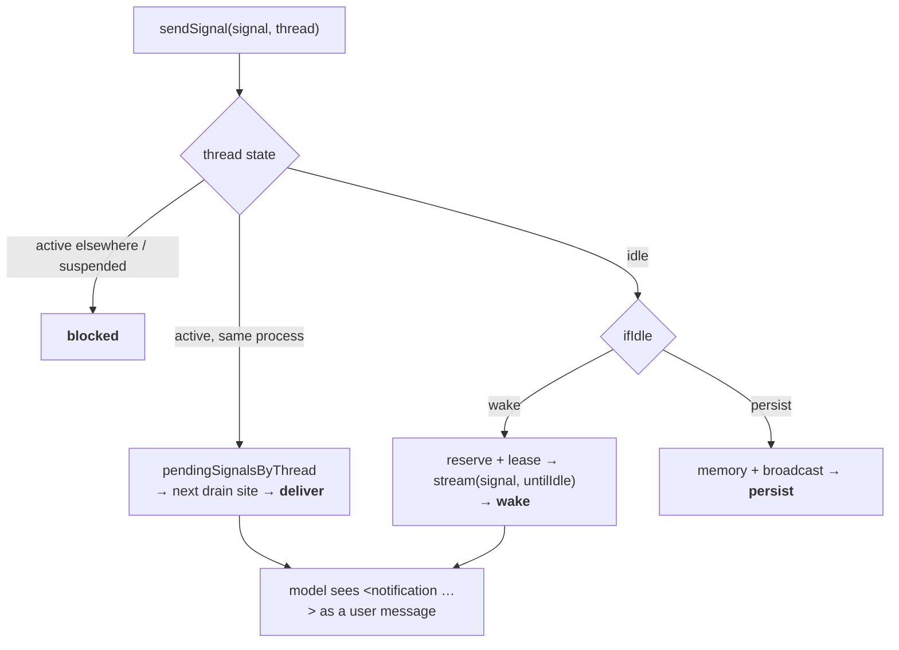

# Module 6: Signals and notifications

**Goal:** master Mastra's answer to "events vs requests" (Module 1.3): typed signals delivered into a thread, routed by thread state (deliver mid-run, wake when idle, persist, block), and the notification layer on top (priority, batching, a dispatcher, an inbox, and `SignalProvider`s for external sources).

**Lab:** [`labs/m06-signals`](https://github.com/rphansen91/mastra-primitives-course/tree/main/labs/m06-signals) (built and tested) · [Lab guide](./lab)

## Pass 1: the problem

An always-on agent gets information it didn't ask for: CI failed, a reviewer commented, the user typed while it was working, a calendar event starts in 10 minutes, a peer agent needs something. For each event you must decide:

- **Is the agent busy?** Then don't start a second run on the same transcript; get the information into the *current* run at a safe point.
- **Is it idle?** Then maybe wake it, or maybe just store it for later.
- **How important is it?** An outage should interrupt; a typo-fix merge should wait in a digest.
- **Where did it come from?** External text must be framed as data, not instructions.

## Pass 2: how it's built

### The signal: one object, three projections

[`agent/signals.ts`](https://github.com/mastra-ai/mastra/blob/ebe143c4916cf20b671a84f942d65d5df469f6cd/packages/core/src/agent/signals.ts) defines a signal's category ([L6](https://github.com/mastra-ai/mastra/blob/ebe143c4916cf20b671a84f942d65d5df469f6cd/packages/core/src/agent/signals.ts#L6)): `user | state | reactive | notification`. [`createSignal`](https://github.com/mastra-ai/mastra/blob/ebe143c4916cf20b671a84f942d65d5df469f6cd/packages/core/src/agent/signals.ts#L561) gives it an `id`, `type`, `contents`, `tagName`, `attributes`, optional `transient`, and `metadata`. The same object has three views:

| Projection | Shape | Who sees it |
|---|---|---|
| `toLLMMessage()` | a **user-role** message: `<notification source="chat" channel="ops">text</notification>` ([`signalToXmlMarkup` L240](https://github.com/mastra-ai/mastra/blob/ebe143c4916cf20b671a84f942d65d5df469f6cd/packages/core/src/agent/signals.ts#L240)) | the model |
| `toDBMessage()` | `MastraDBMessage { role: 'signal', metadata.signal }` | memory/storage |
| `toDataPart()` | a `data-signal` stream chunk | clients subscribed to the thread |

One timeline (the `MessageList`), three audiences. `transient: true` means "deliver to the model, never persist". State signals (task lists, goals) are recomputed per request by `computeStateSignal` processors and can't be transient.

### Routing by thread state

`agent.sendSignal(signal, { resourceId, threadId, ifActive?, ifIdle? })` delegates to [`thread-stream-runtime.ts sendSignal` (L5515)](https://github.com/mastra-ai/mastra/blob/ebe143c4916cf20b671a84f942d65d5df469f6cd/packages/core/src/agent/thread-stream-runtime.ts#L5515) and returns `{ signal, accepted: Promise<{ action, runId?, output? }>, persisted? }`.

| Thread state | Option | Result |
|---|---|---|
| A run is active (same process) | `ifActive: 'deliver'` (default) | queued in `pendingSignalsByThread` ([L418](https://github.com/mastra-ai/mastra/blob/ebe143c4916cf20b671a84f942d65d5df469f6cd/packages/core/src/agent/thread-stream-runtime.ts#L418)), drained at the next drain site → `deliver` |
| | `ifActive: 'persist'` / `'discard'` | stored without interrupting / dropped |
| Reserved, first request not sent yet | | joins the first request (pre-run) |
| Active run owned by **another process**, or **suspended** (approval pending) | | `blocked` ([L5594](https://github.com/mastra-ai/mastra/blob/ebe143c4916cf20b671a84f942d65d5df469f6cd/packages/core/src/agent/thread-stream-runtime.ts#L5594), [L5756](https://github.com/mastra-ai/mastra/blob/ebe143c4916cf20b671a84f942d65d5df469f6cd/packages/core/src/agent/thread-stream-runtime.ts#L5756)) |
| Idle | `ifIdle: 'wake'` (default) | reserve thread → lease (fails open) → `agent.stream(signal, { untilIdle: true, ...streamOptions })` → `wake` with `output` |
| Idle, another process is starting a run | | queued in `pendingIdleSignalsByThread` ([L434](https://github.com/mastra-ai/mastra/blob/ebe143c4916cf20b671a84f942d65d5df469f6cd/packages/core/src/agent/thread-stream-runtime.ts#L434)), flushed when idle |
| Idle | `ifIdle: { behavior: 'persist' }` | written to memory + broadcast → `persist` |
| | `{ wake, requireClaimedOwner: true }` | wakes only if a live claimed owner exists (peer agents, Module 8) |

**Drain sites** (all use [`drainSignalsToTranscript`](https://github.com/mastra-ai/mastra/blob/ebe143c4916cf20b671a84f942d65d5df469f6cd/packages/core/src/loop/shared/steps/signal-drain-core.ts#L35)):

1. building the LLM request (pre-run signals on the first, pending signals afterwards);
2. `signalDrainStep` ([loop-builder L206](https://github.com/mastra-ai/mastra/blob/ebe143c4916cf20b671a84f942d65d5df469f6cd/packages/core/src/loop/loop-builder.ts#L206)): seal the current response message, rotate to a fresh id, add the signal, emit `data-signal`, mark the iteration continued;
3. the predicate's inline drain.

Plus **interruption**: if only reasoning has streamed, a queued signal aborts the physical request ([llm-execution-step L1299](https://github.com/mastra-ai/mastra/blob/ebe143c4916cf20b671a84f942d65d5df469f6cd/packages/core/src/loop/workflows/agentic-execution/llm-execution-step.ts#L1299)) without spending a step.

### Notifications: signals with a policy

`agent.sendNotificationSignal(input, target)` ([agent.ts L9321](https://github.com/mastra-ai/mastra/blob/ebe143c4916cf20b671a84f942d65d5df469f6cd/packages/core/src/agent/agent.ts#L9321)):

1. Writes a `NotificationRecord` (storage domain `notifications`): `source`, `kind`, `priority` (`low | medium | high | urgent`), `summary/body`, `attributes`, `dedupeKey`, `coalesceKey`, `status`, delivery attempts (max 5).
2. Resolves a **delivery decision** from `{ record, threadState }`: custom `decide` first, then `sources`, `priorities`, `default`, then [`defaultNotificationDeliveryDecision`](https://github.com/mastra-ai/mastra/blob/ebe143c4916cf20b671a84f942d65d5df469f6cd/packages/core/src/notifications/delivery-policy.ts#L66):

   | Priority | Thread idle | Thread active |
   |---|---|---|
   | urgent | deliver | deliver |
   | high | deliver | summarize now, then deliver full |
   | medium | deliver | summarize |
   | low | summarize | summarize |

   Actions: `deliver | queue | defer | summarize | persist | discard`, optionally with `deliverAt`, `summaryAt`, `streamOptions` (for wakes), `hold`.
3. `deliver` → `sendSignal` with the routing above. `summarize` → the record waits for the **dispatcher**: [`dispatchDueNotifications`](https://github.com/mastra-ai/mastra/blob/ebe143c4916cf20b671a84f942d65d5df469f6cd/packages/core/src/notifications/dispatcher.ts#L263), run by a lazily created cron workflow every minute, emits one `<notification-summary pending=".." priority="..">github: 1, chat: 1</notification-summary>` per thread. An all-low batch is persisted **without waking**.
4. The agent pulls details on demand with [`createNotificationInboxTool`](https://github.com/mastra-ai/mastra/blob/ebe143c4916cf20b671a84f942d65d5df469f6cd/packages/core/src/notifications/tool.ts#L148) (list/read/markSeen/dismiss/archive/search).

### SignalProvider: the plug-in point for external sources

[`SignalProvider`](https://github.com/mastra-ai/mastra/blob/ebe143c4916cf20b671a84f942d65d5df469f6cd/packages/core/src/signals/signal-provider.ts#L97) is an abstract class with an in-memory subscription registry (`subscribe(target, externalResourceId)`), optional polling ([`startPolling` L374](https://github.com/mastra-ai/mastra/blob/ebe143c4916cf20b671a84f942d65d5df469f6cd/packages/core/src/signals/signal-provider.ts#L374), `pollInterval`), optional `handleWebhook`, and [`notify()` (L446)](https://github.com/mastra-ai/mastra/blob/ebe143c4916cf20b671a84f942d65d5df469f6cd/packages/core/src/signals/signal-provider.ts#L446) which calls `sendNotificationSignal`. Providers can contribute tools and processors (Module 3). Built-ins: `WebhookSignalProvider`, `TaskSignalProvider`, `GoalSignalProvider`, and `@mastra/github-signals`.

### PubSub backends

Everything cross-process (leases, thread ownership, peer discovery, cross-instance delivery) goes through PubSub ([`events/`](https://github.com/mastra-ai/mastra/tree/ebe143c4916cf20b671a84f942d65d5df469f6cd/packages/core/src/events)):

| Backend | Scope | Leases |
|---|---|---|
| `EventEmitterPubSub` (default) | one process | in process |
| `UnixSocketPubSub` | one host (mastracode uses it across local sessions) | yes |
| `@mastra/redis-streams`, `@mastra/valkey-streams` | cluster | yes |
| `@mastra/google-cloud-pubsub` | cluster | **no** |

"Local first, then distributed": you swap the transport, not the API.

## Pass 3: where it falls down

- **Cooperative, not preemptive.** A signal sent during a 10-minute tool is seen after the tool. Only reasoning-only requests are interruptible.
- **In-memory queues.** `pendingSignalsByThread`, `pendingIdleSignalsByThread`, queued messages and provider subscriptions live in process memory. A crash loses accepted-but-undelivered signals (open issues #25778/#25779; draft PR #25729 adds durable subscription storage). Notification *records* are durable; the in-flight queue isn't.
- **Woken runs only get what you pass.** A wake uses `streamOptions` from the delivery decision; without them the run gets defaults (model, tools, approval). And without memory, it gets no history.
- **`transient` + `ifIdle: persist` = discarded.** The lab confirms `{ action: 'discard' }`.
- **`blocked` must be handled.** Suspended threads and threads active in another process return `blocked`; nothing retries for you.
- **Signals can starve stopping.** Preempted requests don't spend `maxSteps`.
- **Untrusted text.** Signal contents are user-role messages. Treat external and peer text as data (tags + instructions + processors), and keep tool approval on for unattended wakes.

## Pass 4: when to choose something else

| Use signals/notifications when | Don't when | Alternatives |
|---|---|---|
| An agent must learn something while working, without a second run | The sender needs a synchronous answer | `agent.generate()`; a tool call on another agent |
| You want priority-aware interrupt/digest behavior | Every event must be processed exactly once, durably, even across crashes | A durable queue (SQS, Kafka, Temporal signals) feeding `sendSignal` idempotently |
| External sources (GitHub, chat, webhooks, schedules) should reach a thread | You only need fan-out to many consumers | PubSub directly |
| Interjections in a chat UI ("user typed while agent works") | | AI SDK UI has no mid-run injection; LangGraph uses `interrupt`/`Command` on a checkpointed graph |

**Compare: Temporal signals.** Temporal signals are **durable** (part of workflow history), delivered exactly once to a workflow's signal handler, and work across crashes and deploys, but they have no notion of a model, a transcript, priority batching or "inject at the next safe point of an LLM loop". Mastra signals have the agent semantics and none of the durability guarantees yet. Unifying the two (durable signal queues, `waitForSignal` with timeout) is one of the capstone candidates.

## Read the source and tests

- [`stream-signals.test.ts`](https://github.com/mastra-ai/mastra/blob/ebe143c4916cf20b671a84f942d65d5df469f6cd/packages/core/src/loop/workflows/stream-signals.test.ts), [`signal-drain-core.test.ts`](https://github.com/mastra-ai/mastra/blob/ebe143c4916cf20b671a84f942d65d5df469f6cd/packages/core/src/loop/shared/steps/signal-drain-core.test.ts), [`agent/signals.test.ts`](https://github.com/mastra-ai/mastra/blob/ebe143c4916cf20b671a84f942d65d5df469f6cd/packages/core/src/agent/signals.test.ts)
- [`notifications/`](https://github.com/mastra-ai/mastra/tree/ebe143c4916cf20b671a84f942d65d5df469f6cd/packages/core/src/notifications) tests; [`signals/`](https://github.com/mastra-ai/mastra/tree/ebe143c4916cf20b671a84f942d65d5df469f6cd/packages/core/src/signals) tests
- Docs: [`harness/signals.mdx`](https://github.com/mastra-ai/mastra/blob/ebe143c4916cf20b671a84f942d65d5df469f6cd/docs/src/content/en/docs/harness/signals.mdx), [`harness/signal-providers.mdx`](https://github.com/mastra-ai/mastra/blob/ebe143c4916cf20b671a84f942d65d5df469f6cd/docs/src/content/en/docs/harness/signal-providers.mdx), [`harness/schedules.mdx`](https://github.com/mastra-ai/mastra/blob/ebe143c4916cf20b671a84f942d65d5df469f6cd/docs/src/content/en/docs/harness/schedules.mdx)
