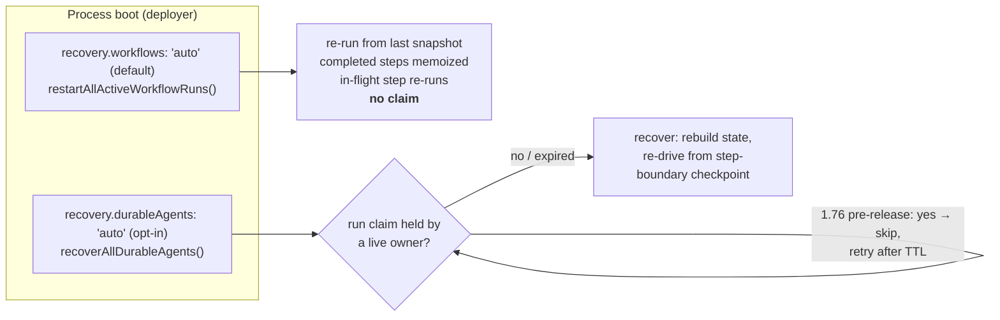

# Module 7: Durability

**Goal:** know precisely what survives a `kill -9` in Mastra and what doesn't: workflow snapshots, durable agents, step-boundary checkpoints, recovery modes, run claims and fencing, and the plain-workflow double run. Then make the side effect exactly-once-effective yourself.

**Lab:** [`labs/m07-durability`](https://github.com/rphansen91/mastra-primitives-course/tree/main/labs/m07-durability): a real crash lab that spawns processes and `SIGKILL`s them · [Lab guide](./lab)

## Pass 1: the problem

Recall Module 1: a journal makes completed steps exactly-once, the in-flight step at-least-once, and only an idempotency key at the receiver closes the gap. A fencing token keeps a stale owner from writing. An agent framework adds two complications:

- The expensive, risky things are **LLM calls** (cost, non-determinism) and **tool calls** (side effects). A replay must not re-ask the model a question it already answered, or the run may take a different path.
- Agent runs are long and conversational, so "restart from scratch" is rarely acceptable.

## Pass 2: how it's built

### Inventory at the pinned commit

| Capability | What exists | Where |
|---|---|---|
| Workflow snapshots | full run state persisted **after every step** on the default engine | [`workflows/default.ts`](https://github.com/mastra-ai/mastra/blob/ebe143c4916cf20b671a84f942d65d5df469f6cd/packages/core/src/workflows/default.ts), [`handlers/entry.ts`](https://github.com/mastra-ai/mastra/blob/ebe143c4916cf20b671a84f942d65d5df469f6cd/packages/core/src/workflows/handlers/entry.ts#L195) |
| Workflow crash recovery | `recovery.workflows: 'auto'` (default) → `restartAllActiveWorkflowRuns()` on boot re-runs RUNNING/WAITING runs from the last snapshot. **No ownership claim.** | [`workflow.ts` L3386](https://github.com/mastra-ai/mastra/blob/ebe143c4916cf20b671a84f942d65d5df469f6cd/packages/core/src/workflows/workflow.ts#L3386), [`mastra/index.ts` L671](https://github.com/mastra-ai/mastra/blob/ebe143c4916cf20b671a84f942d65d5df469f6cd/packages/core/src/mastra/index.ts#L671) |
| Durable agents | `createDurableAgent` / `createEventedAgent` / `createInngestAgent`: the agentic loop as an outer `durable-agentic-loop` workflow wrapping an inner `durable-agentic-execution` (LLM → foreach tools → mapping → bg check → signal drain → goal) | [`agent/durable/`](https://github.com/mastra-ai/mastra/tree/ebe143c4916cf20b671a84f942d65d5df469f6cd/packages/core/src/agent/durable), [`durable-loop-builder.ts`](https://github.com/mastra-ai/mastra/blob/ebe143c4916cf20b671a84f942d65d5df469f6cd/packages/core/src/agent/durable/workflows/durable-loop-builder.ts) |
| Agent checkpoints | with `recovery.durableAgents: 'auto'`, a `running` checkpoint at **every step boundary** (per LLM step, per tool-call step; not mid-stream). Off by default. | [`harness/durable-agents.mdx`](https://github.com/mastra-ai/mastra/blob/ebe143c4916cf20b671a84f942d65d5df469f6cd/docs/src/content/en/docs/harness/durable-agents.mdx) |
| Agent recovery | `recoverAllDurableAgents()` on boot; `recover(runId)`, `recoverActiveRuns()`; rebuilds MessageList/memory/requestContext; redoes work after the snapshot | [`run-recovery.md`](https://github.com/mastra-ai/mastra/blob/ebe143c4916cf20b671a84f942d65d5df469f6cd/packages/core/src/agent/durable/run-recovery.md) |
| Run claims + fencing | claim TTL 30 s, renewed every 10 s, with **generations**; with a fencing store (InMemory, pg, libSQL, Turso) every snapshot/memory write is checked atomically, stale writers get `RunFenceConflictError` | [`execution-fence.ts` L36](https://github.com/mastra-ai/mastra/blob/ebe143c4916cf20b671a84f942d65d5df469f6cd/packages/core/src/agent/durable/execution-fence.ts#L36), [`leases.md`](https://github.com/mastra-ai/mastra/blob/ebe143c4916cf20b671a84f942d65d5df469f6cd/packages/core/src/agent/durable/leases.md), [`stores/pg/.../run-fencing.ts`](https://github.com/mastra-ai/mastra/blob/ebe143c4916cf20b671a84f942d65d5df469f6cd/stores/pg/src/storage/db/run-fencing.ts) |
| Other leases | thread lease (one run per thread, 15 s / 5 s), thread-claim lease, evented step fence, background-task lease | [`leases.md`](https://github.com/mastra-ai/mastra/blob/ebe143c4916cf20b671a84f942d65d5df469f6cd/packages/core/src/agent/durable/leases.md) |
| Idempotency seam | `wrapDurableOperation(operationId, fn)`: a no-op on the default engine, `step.run` on Inngest | [`default.ts` L173](https://github.com/mastra-ai/mastra/blob/ebe143c4916cf20b671a84f942d65d5df469f6cd/packages/core/src/workflows/default.ts#L173) |
| Engines | default (in process), evented (PubSub + workers), Inngest, Temporal (experimental) | [`workflows/`](https://github.com/mastra-ai/mastra/tree/ebe143c4916cf20b671a84f942d65d5df469f6cd/packages/core/src/workflows), [`workflows/inngest`](https://github.com/mastra-ai/mastra/tree/ebe143c4916cf20b671a84f942d65d5df469f6cd/workflows/inngest), [`workflows/temporal`](https://github.com/mastra-ai/mastra/tree/ebe143c4916cf20b671a84f942d65d5df469f6cd/workflows/temporal) |

### Recovery modes

### The version difference you'll see in the lab

This is the most important thing the crash lab teaches, because it's a real behavior change between the published package and `main`:

| Observation | `@mastra/core@1.75.0` (published 2026-10-07) | `1.76.0-alpha.9` ≈ main at the pinned commit |
|---|---|---|
| Recovery right after `kill -9` | recovers immediately (t+4 s) | **skips** while the dead owner's claim is unexpired (≈30 s), then recovers |
| LLM calls / completed tools repeated on recovery | no | no |
| In-flight tool re-executed | yes | yes |
| Second replica boots while first is alive: **plain workflow** | in-flight step runs in **both** processes | in-flight step runs in **both** processes |
| Second replica: **durable agent** | replica **re-drives the live run** (tool runs twice, second final LLM call) | replica leaves it alone (claim held by live owner) |

The 1.75.0 docs say so plainly: "Mastra doesn't provide a distributed lease or lock yet. In multi-replica deployments, every replica that starts with `recovery.durableAgents: 'auto'` will race to recover the same runs." The claims and libSQL/pg fencing landed on main just before the pinned commit. CI runs the lab on both versions; the test asserts the version-appropriate behavior.

## Pass 3: where it breaks

Observed in the [crash lab](./lab):

1. **The in-flight tool re-runs.** Granularity is the step, not the side effect. `slow_deploy` started twice.
2. **No idempotency key reaches the tool.** On 1.75.0 a regular agent's tool context has `runId` and `agent.toolCallId`; a **durable** agent's tool context has `toolCallId` but **no `runId`**. You have to route the run id yourself (the lab uses `RequestContext`, which the snapshot persists).
3. **Plain workflows double-run with replicas.** `restartAllActiveWorkflowRuns()` has no claim; with `recovery.workflows: 'auto'` (the default!) and two instances sharing a DB, in-flight steps execute twice concurrently.
4. **Recovery is boot-time or explicit.** No continuous orphan sweeper.

From source and docs at the pinned commit:

5. **Off by default.** A plain `Agent.stream()` isn't checkpointed at all; durable agents checkpoint `running` state only with `recovery.durableAgents: 'auto'`.
6. **Timers and events aren't durable on the default engine** (Module 5), and **signal queues are in memory** (Module 6).
7. **No versioning of in-flight code-defined workflows**; no event-history replay debugger.
8. **Sub-agent delegation is one opaque step**: recovery reruns the whole sub-agent (the docs warn about this).

## Pass 4: when to choose something else

| Use Mastra durable agents when | Don't when | Alternatives |
|---|---|---|
| Long agent runs must survive deploys/crashes, and you can make tools idempotent | Tools have non-idempotent effects you can't key | Put the effect behind a durable engine activity (Temporal, Restate `ctx.run`, DBOS step) |
| Single instance, or a fencing store (pg/libSQL/Turso) on a version with claims | Multi-replica on 1.75.x with auto recovery | Leader-elect recovery yourself; `createInngestAgent` (per-tool memoization via Inngest steps) |
| You want the same agent code to run in-process and on Inngest/Temporal later | You need durable timers/signals/versioning today | Temporal, Restate, DBOS, Cloudflare Workflows, Vercel Workflow |

**Compare: Restate / DBOS.** Both journal **every** side effect inside a handler (`ctx.run(name, fn)` / `@DBOS.step()`), so an in-flight effect's *completed* sub-steps are memoized and only the exact in-flight call can repeat, and both hand you a stable idempotency key for it. Mastra's unit is the workflow step (one LLM call, one tool call). That's the biggest gap, and it's capstone candidate #1: journaled tool results and an idempotency key on every tool call.

## Recommendations if you run this in production today

- Use `createDurableAgent` + `recovery.durableAgents: 'auto'` with a **fencing store** (Postgres/libSQL/Turso) on a version with run claims, plus a distributed PubSub with leases (Redis/Valkey Streams).
- Make every outward tool idempotent: key on `runId:toolCallId` (route `runId` through `RequestContext` if your version's durable tool context lacks it).
- Set `recovery.workflows: 'off'` on multi-instance deployments unless workflow steps are idempotent, or run one instance.
- Persist provider subscriptions yourself (Module 6).

## Read the source and tests

- [`run-recovery.md`](https://github.com/mastra-ai/mastra/blob/ebe143c4916cf20b671a84f942d65d5df469f6cd/packages/core/src/agent/durable/run-recovery.md) and [`leases.md`](https://github.com/mastra-ai/mastra/blob/ebe143c4916cf20b671a84f942d65d5df469f6cd/packages/core/src/agent/durable/leases.md): design docs, read in full.
- [`execution-fence.test.ts`](https://github.com/mastra-ai/mastra/blob/ebe143c4916cf20b671a84f942d65d5df469f6cd/packages/core/src/agent/durable/execution-fence.test.ts)
- [`durable-operation-ids.test.ts`](https://github.com/mastra-ai/mastra/blob/ebe143c4916cf20b671a84f942d65d5df469f6cd/packages/core/src/workflows/durable-operation-ids.test.ts)
- [`agent/durable/__tests__/`](https://github.com/mastra-ai/mastra/tree/ebe143c4916cf20b671a84f942d65d5df469f6cd/packages/core/src/agent/durable/__tests__)
