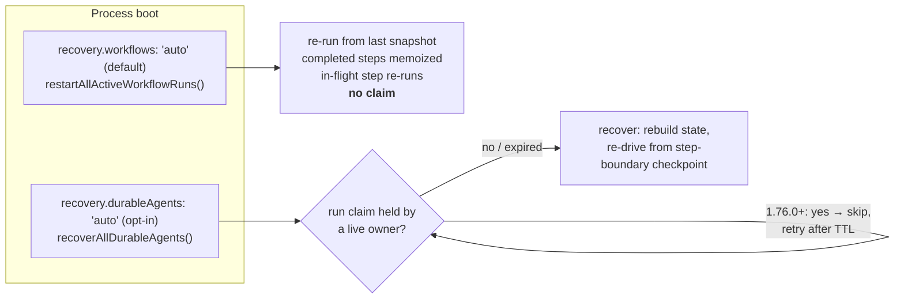

---
verified:
  core: 1.76.0
  sha: 81299c921d6f499d4c62f14c38e4d4d88b4fbfae
  date: '2026-10-11'
pageClass: lesson
aside: false
---

# Module 7: Durability

"Durable" is one of those words that means whatever the person saying it hopes it means. In this module you'll kill real processes with <code>kill -9</code> and write down exactly what comes back, what runs twice, and what's just gone.

<LessonHero module="07" :minutes="45" lab="Real kill -9 crash lab, ~40 s" :outcomes="outcomes" mood="alarmed">

**Thursday, 11:03 pm.** You ship a small fix. Kubernetes rolls the deployment and sends `SIGKILL` to the old pod, which was in the middle of upgrading a customer to Pro.

The new pod boots, finds the half-finished run, and helpfully recovers it. The card gets charged. Again. You were using a durable agent. **So what went wrong?**

</LessonHero>

<Journey :station="1" module="07" />

## The problem {#problem}

Module 1 gave you the rules: a journal makes finished steps exactly-once, the in-flight step stays at-least-once, and only an idempotency key at the receiver closes the gap. A fencing token keeps zombies from writing.

Agents add three twists:

<IdeaCards :cards="twists" />

<Quiz module="07" id="why-not-reask" question="Why must recovery avoid re-asking the model a question it already answered?" :options="q_why" />

<StationDone module="07" :station="1" />

<Journey :station="2" module="07" />

## Under the hood {#under-the-hood}

Start by breaking things. This is Thursday night, with every knob exposed. Try each mode, kill it mid-`charge_card` after the lightning bolt, and then flip on the idempotency key:

<CrashSimulator variant="durable" />

<Callout type="note" title="What you should have found">

Plain `agent.stream()` keeps nothing, so a retry is a whole new run. A durable agent brings back every **completed** step, but re-runs the **in-flight** one from its start. Only the idempotency key stops the double charge. That's Thursday night explained.

</Callout>

<RecoveryMap />

### The toolbox

Mastra's durability is a set of parts that fit together. Click through them:

<ClickMap title="Durability parts at the pinned commit" :stations="toolbox" />

### Recovery modes

### Two versions, two behaviors

The crash lab runs on both 1.76.0 (pinned) and 1.75.0 (previous stable) in CI, because the behavior genuinely changed in a minor release:

| What you observe | `@mastra/core@1.75.0` | `@mastra/core@1.76.0` (pinned) |
|---|---|---|
| Recovery right after `kill -9` | immediate (t+4 s) | **waits** for the dead owner's claim (≈30 s) |
| LLM calls / completed tools repeated | no | no |
| In-flight tool re-executed | **yes** | **yes** |
| Second replica, plain workflow | in-flight step runs **twice** | in-flight step runs **twice** |
| Second replica, durable agent | replica **re-drives** the live run | replica leaves it alone |

<Quiz kind="predict" module="07" id="replica" question="A second replica boots while the first is still happily running a durable agent. Both use `recovery.durableAgents: 'auto'`. What does the replica do?" :options="q_replica" />

<TryIt cmd="npm run lab:crash" :output="out1">

Spawns real child processes, `SIGKILL`s one mid-`slow_deploy`, and recovers from a libSQL file. The solution's idempotency key turns the second deploy into `deduped`.

</TryIt>

<DeepDive title="Design docs, fencing in storage, and tests">

Read these two in full; they're the authors' own design notes:

- [`run-recovery.md`](https://github.com/mastra-ai/mastra/blob/81299c921d6f499d4c62f14c38e4d4d88b4fbfae/packages/core/src/agent/durable/run-recovery.md)
- [`leases.md`](https://github.com/mastra-ai/mastra/blob/81299c921d6f499d4c62f14c38e4d4d88b4fbfae/packages/core/src/agent/durable/leases.md): the run claim plus the thread lease (one run per thread, 15 s / 5 s), the thread-claim lease, the evented step fence and the background-task lease.

Where the pieces live:

- [`durable-loop-builder.ts`](https://github.com/mastra-ai/mastra/blob/81299c921d6f499d4c62f14c38e4d4d88b4fbfae/packages/core/src/agent/durable/workflows/durable-loop-builder.ts): the durable loop, same steps as Module 2.
- [`mastra/index.ts` L671](https://github.com/mastra-ai/mastra/blob/81299c921d6f499d4c62f14c38e4d4d88b4fbfae/packages/core/src/mastra/index.ts#L671): boot-time recovery.
- [`stores/pg/.../run-fencing.ts`](https://github.com/mastra-ai/mastra/blob/81299c921d6f499d4c62f14c38e4d4d88b4fbfae/stores/pg/src/storage/db/run-fencing.ts): fencing as one atomic conditional write.

Tests:

- [`execution-fence.test.ts`](https://github.com/mastra-ai/mastra/blob/81299c921d6f499d4c62f14c38e4d4d88b4fbfae/packages/core/src/agent/durable/execution-fence.test.ts)
- [`durable-operation-ids.test.ts`](https://github.com/mastra-ai/mastra/blob/81299c921d6f499d4c62f14c38e4d4d88b4fbfae/packages/core/src/workflows/durable-operation-ids.test.ts)
- [`agent/durable/__tests__/`](https://github.com/mastra-ai/mastra/tree/81299c921d6f499d4c62f14c38e4d4d88b4fbfae/packages/core/src/agent/durable/__tests__)

The 1.75.0 docs said it plainly: *"Mastra doesn't provide a distributed lease or lock yet. In multi-replica deployments, every replica that starts with `recovery.durableAgents: 'auto'` will race to recover the same runs."* The [1.76.0 docs](https://github.com/mastra-ai/mastra/blob/81299c921d6f499d4c62f14c38e4d4d88b4fbfae/docs/src/content/en/docs/harness/durable-agents.mdx#L388) replace that with run ownership: *"Every replica can start with `recovery.durableAgents: 'auto'` … This requires a claim that every replica shares: a workflows store that supports run fencing, or a PubSub backend whose lease every replica shares."* Without either, you still need your own leader election. To take over a run held by a hung execution, 1.76.0 adds `recover(runId, { force: true })`.

</DeepDive>

### The durable path is not the regular path

A `DurableAgent` runs the same loop builder as a regular `Agent` (one `AgenticLoopBuilder` with durable overrides, since [#24569](https://github.com/mastra-ai/mastra/pull/24569)). But anything that has to cross a process boundary gets serialized, and some things can't be. These are verified at the pin:

| You configure | On the durable path | Evidence |
|---|---|---|
| `stopWhen` / `onIterationComplete` closures | Parked in an **in-process** registry. After recovery in another process, they're gone, and only `maxSteps` bounds the loop | [`preparation.ts` L887–890](https://github.com/mastra-ai/mastra/blob/81299c921d6f499d4c62f14c38e4d4d88b4fbfae/packages/core/src/agent/durable/preparation.ts#L887) |
| `structuredOutput` | Only the `schema` is persisted and rebuilt on recovery. Options without a schema don't survive | [`durable-agent.ts` L1461–1467](https://github.com/mastra-ai/mastra/blob/81299c921d6f499d4c62f14c38e4d4d88b4fbfae/packages/core/src/agent/durable/durable-agent.ts#L1461) |
| `RequestContext` entries | Persisted as JSON entries and restored on recovery. Non-JSON values (class instances, functions, clients) don't come back. The auth token is deliberately never persisted | [`resolve-runtime.ts` L105–125](https://github.com/mastra-ai/mastra/blob/81299c921d6f499d4c62f14c38e4d4d88b4fbfae/packages/core/src/agent/durable/utils/resolve-runtime.ts#L105), [`subagents.mdx` L144](https://github.com/mastra-ai/mastra/blob/81299c921d6f499d4c62f14c38e4d4d88b4fbfae/docs/src/content/en/docs/subagents.mdx#L144) |
| `eagerToolExecution: true` | Throws: *"not supported by durable agents"* | [`preparation.ts` L348](https://github.com/mastra-ai/mastra/blob/81299c921d6f499d4c62f14c38e4d4d88b4fbfae/packages/core/src/agent/durable/preparation.ts#L348) |
| Tool context | Has `toolCallId` but no `runId` (verified on 1.75.0 and 1.76.0 by printing the context keys) | Lab 7, [`phase-run.ts`](https://github.com/rphansen91/mastra-primitives-course/blob/main/labs/m07-durability/phase-run.ts) |

<Callout type="warn" title="The crash lab is cross-process, so a stopWhen guard wouldn't survive it">

Module 2's `stopOnRepeat` guard is a closure. A run recovered in a fresh process loses it and falls back to `maxSteps`. If a stop rule must hold after recovery, express it in something that's persisted: `maxSteps`, a processor registered on the agent, or a tool-level check.

</Callout>

### What `recover()` does, and refuses

From [`run-recovery.md`](https://github.com/mastra-ai/mastra/blob/81299c921d6f499d4c62f14c38e4d4d88b4fbfae/packages/core/src/agent/durable/run-recovery.md):

- **Restores** the message list, memory, request context (JSON entries) and the tracing span from the last `running` snapshot, raises the memory fence to the new claim's generation, then restarts the workflow. **Every step after the snapshot runs again**, including model and tool calls. Message ids come from the snapshot, so the redo *upserts* rather than appending duplicates.
- **Doesn't restore** anything that lived only in the dead process: closures, caches, open connections, in-memory signal queues.
- **Refuses suspended runs.** A run waiting on an approval isn't orphaned: `recover()` throws `DURABLE_AGENT_RECOVER_RUN_SUSPENDED` and you continue it with `resume()`. The server route maps run-state conflicts like this one to **409**.
- **Skips live runs.** `recoverActiveRuns()` reports `skipped` with reason `run-active` and a `retryAt`. `recoverAllDurableAgents()` re-checks at `retryAt` plus up to 5 s of jitter, so replicas that booted together spread out.
- **Replays whole delegations.** A sub-agent call is one tool call to the parent, so a replayed delegation restarts the entire sub-agent run, including tool side effects that already completed ([docs warning](https://github.com/mastra-ai/mastra/blob/81299c921d6f499d4c62f14c38e4d4d88b4fbfae/docs/src/content/en/docs/harness/durable-agents.mdx#L293), [#25194](https://github.com/mastra-ai/mastra/pull/25194)). **Sub-agent tools need idempotency keys too.** Declaring which tools are replay-safe is an open feature request, [#25780](https://github.com/mastra-ai/mastra/issues/25780).

### Shutdown is part of durability

`mastra.shutdown({ drainTimeout })` gives in-flight runs up to `drainTimeout` ms (**default 5000**) to settle ([`mastra/index.ts` L7679](https://github.com/mastra-ai/mastra/blob/81299c921d6f499d4c62f14c38e4d4d88b4fbfae/packages/core/src/mastra/index.ts#L7679)). Since 1.76.0 ([#26642](https://github.com/mastra-ai/mastra/pull/26642)), a durable agent writes a `running` checkpoint at each step boundary it reaches during the drain, **even with `recovery.durableAgents: 'off'`**. Runs still going at the deadline are abandoned without writing, and their claims are released, so the next boot can recover them right away instead of waiting about 30 s for the claims to lapse. A run stuck inside one long tool call for the whole drain gets no checkpoint.

<StationDone module="07" :station="2" />

<Journey :station="3" module="07" />

## Break it {#break-it}

Four things the crash lab catches in the act:

<IdeaCards :cols="2" :cards="observed" />

<Misconception myth="A durable agent runs every tool exactly once.">

It runs every **completed step** exactly once. The step that was running when the process died runs again from its start. If that step charged a card before the crash, it charges again, unless the payments API dedupes on a key.

</Misconception>

<Misconception myth="Durable means my agent is checkpointed by default.">

A plain `Agent.stream()` isn't checkpointed at all. Durable agents checkpoint `running` state at every step only with `recovery.durableAgents: 'auto'`. With recovery off (the default), they checkpoint only at step boundaries reached during `mastra.shutdown()`'s drain (1.76.0+), so a `kill -9` leaves nothing to recover. Timers and events aren't durable on the default engine (Module 5), and signal queues live in memory (Module 6).

</Misconception>

### Your mission: stop the double deploy

<Callout type="tip" title="Exercise 7.1">

The starter's `deployKey()` returns `undefined`, so the deploy API can't tell a recovery retry from a new deploy. Return a key that's **identical** when the same tool call re-runs after a crash, and **different** for a genuinely new call. File: `exercises/ex1-idempotency-key.ts`.

</Callout>

<Quiz module="07" id="key" question="Which key does the job?" :options="q_key" explain="On 1.75.0 and 1.76.0 the durable tool context has no `runId`, so the lab passes it through `RequestContext`, which the snapshot persists." />

<TryIt :cmd="exCmd">

The first command shows the ledger with two `applied (no key)` entries. The test fails until your key makes the second one `deduped`. Full solution on the [lab page](./lab#break-it-exercise-7-1-the-double-deploy).

</TryIt>

<StationDone module="07" :station="3" />

<Journey :station="4" module="07" />

## Choose wisely {#choose-wisely}

<Choose subject="Mastra durable agents" :rows="choose" />

<Callout type="analogy" title="Save points vs autosave">

Mastra durable agents are a video game with **save points between levels**. Die mid-level and you replay that whole level. Restate and DBOS are **autosave**: they journal every side effect inside a handler (`ctx.run(name, fn)` / `@DBOS.step()`), so only the exact call in flight can repeat, and they hand you a stable key for it.

That gap (journaled tool results, plus an idempotency key on every tool call) is capstone candidate #1 in Module 10.

</Callout>

### If you run this in production today

<IdeaCards :cols="2" :cards="prod" />

## Production readiness {#production-readiness}

The review a cautious platform team would write before putting this module's primitives on a critical path. Every badge links to its source at the pinned release. For the course-wide decision, see [Adopting Mastra in production](../adopting).

<ProdReadiness module="07" />

<StationDone module="07" :station="4" next="./lab" next-label="On to the crash lab" />

## Wrap-up

<Podcast title="Durability, in five minutes" :minutes="5">

**Host:** Thursday night. Durable agent, and the card still got charged twice. Why?

**Loopy:** Because durable agents save at step boundaries. One model call is a step, one tool call is a step. When the pod died, the charge tool was in the middle of its step. Its effect had already happened, but the step hadn't finished, so there was no checkpoint after it.

**Host:** So on recovery…

**Loopy:** Everything that finished comes back from the snapshot. The model isn't asked again, finished tools don't run again. But the in-flight step runs again from the top. Charge, again.

**Host:** How do I fix it?

**Loopy:** Give the payments API an idempotency key that's the same every time this exact tool call runs: the run id plus the tool call id. Both survive recovery. On 1.75.0 and 1.76.0 the durable tool context doesn't include the run id, so pass it through the request context.

**Host:** What about two replicas?

**Loopy:** On 1.75.0 there's no lock. A second replica that boots with auto recovery will re-drive a run that's still alive. 1.76.0 adds run claims with generations and fencing: a live owner holds the claim, and stale writers get rejected, as long as the store supports fencing or the PubSub lease is shared. And watch out for plain workflows: their auto recovery is on by default and has no claim, so in-flight steps can run twice on two instances.

**Host:** Is any of this on by default?

**Loopy:** Workflow recovery, yes. Durable agent recovery, no. And a plain agent.stream run isn't checkpointed at all.

**Host:** Last one: Temporal or Mastra?

**Loopy:** If your tools can be made idempotent and step-level saves are enough, Mastra's durable agents are great, and the same code can move to Inngest or Temporal later. If you need every side effect journaled, durable timers, or workflow versioning today, use a durable engine.

</Podcast>

<Recall module="07" :cards="recall" />

<CheatCard module="07" title="Durability" subtitle="What survives a kill -9" :cells="cheat" />

<Callout type="win" title="Where next">

- **[Lab 7: the crash lab](./lab):** two scenarios, real processes, real `SIGKILL`.
- **[Module 8: Multi-agent coordination](/m08/)**
- **[Module 10: Capstone](/m10/):** design the primitive that closes the gap you just found.

</Callout>
