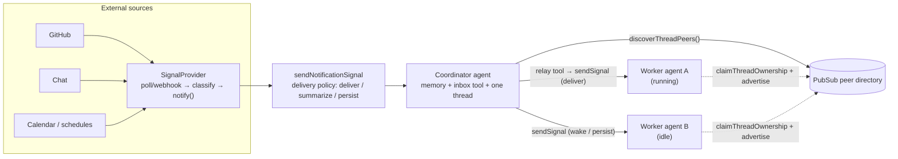

# Module 8: Multi-agent coordination

**Goal:** choose between the four ways Mastra agents work together (sub-agents as tools, networks, workflows, and signals between threads) by understanding what each one shares (transcript, run, budget, failure). Study mastracode's agent-to-agent messaging as a production case, and build the **always-on coordinator** pattern.

**Lab:** [`labs/m08-multi-agent`](https://github.com/rphansen91/mastra-primitives-course/tree/main/labs/m08-multi-agent) (built and tested) · [Lab guide](./lab)

## Pass 1: the problem

"Multi-agent" hides very different needs:

- **Delegation:** "research this and give me the answer" (a function call that happens to be an agent).
- **Orchestration:** a known pipeline where some steps are agents.
- **Routing:** a supervisor that picks which specialist should handle each turn.
- **Coordination of independent, long-lived agents:** a coordinator that tells three busy coding agents "the CI is rate limited, stagger your pushes", *while they keep working*.

Each needs a different answer to: whose transcript? whose run? who pays the step budget? what happens when one fails or crashes?

## Pass 2: how it's built

### The four mechanisms

| Mechanism | How | Shares | Source |
|---|---|---|---|
| **Sub-agent as a tool** | `agents: { researcher }` on an agent; the model calls `agent-researcher` | caller's run waits; the sub-agent's whole run is one tool call | [`agent/subagent.ts`](https://github.com/mastra-ai/mastra/blob/ebe143c4916cf20b671a84f942d65d5df469f6cd/packages/core/src/agent/subagent.ts), [`docs/subagents.mdx`](https://github.com/mastra-ai/mastra/blob/ebe143c4916cf20b671a84f942d65d5df469f6cd/docs/src/content/en/docs/subagents.mdx) |
| **Agent network** | a routing agent picks agents/workflows/tools per iteration | one network run | [`agents/networks.mdx`](https://github.com/mastra-ai/mastra/blob/ebe143c4916cf20b671a84f942d65d5df469f6cd/docs/src/content/en/docs/agents/networks.mdx), [`agent-network.test.ts`](https://github.com/mastra-ai/mastra/blob/ebe143c4916cf20b671a84f942d65d5df469f6cd/packages/core/src/agent/agent-network.test.ts) |
| **Workflow with agent steps** | `createStepFromAgent` in `.then/.parallel/.foreach` | the workflow run; each agent step is a step (snapshot, retry) | [`workflows/agents-and-tools.mdx`](https://github.com/mastra-ai/mastra/blob/ebe143c4916cf20b671a84f942d65d5df469f6cd/docs/src/content/en/docs/workflows/agents-and-tools.mdx) |
| **Signals between threads** | `otherAgent.sendSignal(signal, { resourceId, threadId })`; ownership + peer discovery | nothing but the message: separate threads, runs, budgets | [`thread-stream-runtime.ts`](https://github.com/mastra-ai/mastra/blob/ebe143c4916cf20b671a84f942d65d5df469f6cd/packages/core/src/agent/thread-stream-runtime.ts#L5515), [agent.ts L9005-9042](https://github.com/mastra-ai/mastra/blob/ebe143c4916cf20b671a84f942d65d5df469f6cd/packages/core/src/agent/agent.ts#L9005) |

### Thread ownership and peer discovery

- [`claimThreadOwnership`](https://github.com/mastra-ai/mastra/blob/ebe143c4916cf20b671a84f942d65d5df469f6cd/packages/core/src/agent/agent.ts#L9005) takes a lease-backed claim on a thread and **advertises** it as a peer with a label/title.
- [`discoverThreadPeers`](https://github.com/mastra-ai/mastra/blob/ebe143c4916cf20b671a84f942d65d5df469f6cd/packages/core/src/agent/agent.ts#L9042) asks over PubSub (request/reply) who's out there.
- `sendSignal(..., { ifIdle: { behavior: 'wake', requireClaimedOwner: true } })` wakes a peer only if a live owner exists.

With the default `EventEmitterPubSub` this works inside one process; with `UnixSocketPubSub` across processes on a host; with Redis/Valkey Streams across a cluster.

### Case study: mastracode agent connections

mastracode (the coding agent in [`mastracode/`](https://github.com/mastra-ai/mastra/tree/ebe143c4916cf20b671a84f942d65d5df469f6cd/mastracode)) lets separate sessions on one machine message each other. [`createMastraCodeAgentController`](https://github.com/mastra-ai/mastra/blob/ebe143c4916cf20b671a84f942d65d5df469f6cd/mastracode/sdk/src/index.ts#L504) wires:

- [`agent-connections/tools.ts`](https://github.com/mastra-ai/mastra/blob/ebe143c4916cf20b671a84f942d65d5df469f6cd/mastracode/sdk/src/agent-connections/tools.ts): `agent_connections_list`, `agent_connect` / `agent_disconnect`, and `agent_signal_send`, which sends a **notification** (`source: 'agent-connection'`, `kind: 'peer-signal'`, with `expectsReply`, `messageId`, `replyTo`) and wakes the peer only with `requireClaimedOwner` (or persists, for low priority);
- [`session-advertisement.ts`](https://github.com/mastra-ai/mastra/blob/ebe143c4916cf20b671a84f942d65d5df469f6cd/mastracode/sdk/src/agent-connections/session-advertisement.ts): each session claims its thread and advertises a peer label, and yields ownership on exit;
- [`messaging-processor.ts`](https://github.com/mastra-ai/mastra/blob/ebe143c4916cf20b671a84f942d65d5df469f6cd/mastracode/sdk/src/agent-connections/messaging-processor.ts): an **output processor** that reminds/retries when a peer expected a reply and the agent didn't send one;
- [`untrusted-text.ts`](https://github.com/mastra-ai/mastra/blob/ebe143c4916cf20b671a84f942d65d5df469f6cd/mastracode/sdk/src/agent-connections/untrusted-text.ts): peer text is framed as **untrusted data**;
- [`utils/signals-pubsub.ts`](https://github.com/mastra-ai/mastra/blob/ebe143c4916cf20b671a84f942d65d5df469f6cd/mastracode/sdk/src/utils/signals-pubsub.ts): a `UnixSocketPubSub` per resource, plus a shared directory for cross-project discovery;
- [`plugins/signal-lane.ts`](https://github.com/mastra-ai/mastra/blob/ebe143c4916cf20b671a84f942d65d5df469f6cd/mastracode/sdk/src/plugins/signal-lane.ts): plugin-contributed signal providers kept out of the constructor so they can be hot-removed.

Every piece is an existing primitive (notifications, ownership, processors, PubSub). No new core API was needed: the house rules working as intended.

### The always-on coordinator pattern

A generic design for "one long-lived agent that watches everything and coordinates workers":

1. **Ingestion:** a `SignalProvider` per source family; classify each event to a priority (an LLM classifier, rules, or Mastra's `Classifier`); `notify()` with a `dedupeKey`.
2. **Policy:** `notifications.deliveryPolicy.decide` maps your labels onto `deliver / summarize / persist / discard`; return `streamOptions` so woken runs get the right model/tools/approval settings.
3. **One coordinator thread** with storage-backed memory and the inbox tool (summaries say "check the inbox"; the agent pulls details).
4. **Time:** threaded schedules send signals into the coordinator thread (morning brief, meeting prep).
5. **Relay:** the coordinator discovers peers and `sendSignal`s into their threads; running workers get the message at their next safe point.
6. **Safety:** all inbound and peer text is untrusted; tool approval stays on for outward actions on unattended wakes; idempotent tools.
7. **Deployment:** more than one instance needs a PubSub with leases; persist provider subscriptions.

## Pass 3: where it falls down

- **Sub-agents are opaque to durability.** A crash replays the whole delegation (Module 7).
- **Sub-agents share the caller's latency and budget.** A slow sub-agent blocks the parent's step; its steps don't show in the parent's `maxSteps`.
- **Signals are fire-and-forget.** There's no built-in request/reply correlation in core; mastracode builds it with `messageId`/`replyTo` and a processor. Lost signals (in-memory queues, Module 6) aren't retried.
- **In-process discovery only by default.** `EventEmitterPubSub` peers vanish across processes.
- **Prompt injection between agents.** A compromised or confused peer is an untrusted input source. Frame it as data and keep approvals.
- **Feedback loops.** Two agents that relay to each other can wake each other forever. Add hop counts or dedupe keys.

## Pass 4: when to choose something else

| Need | Choose | Not | Alternatives |
|---|---|---|---|
| "Answer this sub-question" inside one turn | sub-agent as tool | signals (no reply), workflow (overkill) | AI SDK tool that calls `generateText`; LangGraph subgraph |
| Known pipeline with agent steps | workflow + `createStepFromAgent` | network (routing overhead) | LangGraph graph; Temporal workflow + activities |
| Dynamic routing among specialists per turn | agent network | hand-written if/else in a tool | LangGraph supervisor; OpenAI Agents SDK handoffs |
| Independent long-lived agents that must inform each other mid-work | signals + ownership + discovery | sub-agents (they'd block) | a message bus + your own mailbox; AutoGen/actor frameworks |
| Cross-host coordination | signals over Redis/Valkey Streams PubSub | default EventEmitter PubSub | Temporal signals between workflows (durable, no agent semantics) |

**Compare: OpenAI Agents SDK handoffs.** A handoff transfers the *conversation* to another agent (the new agent continues the same run with the transcript). That's routing within one run, like a Mastra network. Signals are the opposite: separate runs and transcripts that exchange messages. Know which one you want before you pick.

## Read the source and tests

- [`mastracode/sdk/src/agent-connections/__tests__/`](https://github.com/mastra-ai/mastra/tree/ebe143c4916cf20b671a84f942d65d5df469f6cd/mastracode/sdk/src/agent-connections/__tests__): includes a real cross-process Unix-socket suite (ownership fencing, lease takeover from killed holders, request/reply).
- [`agent/__tests__/`](https://github.com/mastra-ai/mastra/tree/ebe143c4916cf20b671a84f942d65d5df469f6cd/packages/core/src/agent/__tests__) for sub-agent and network behavior.
