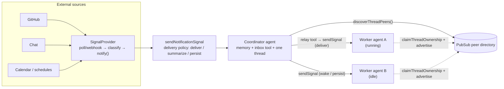

# Module 8: Multi-agent coordination

"Multi-agent" is one word for four very different shapes. You tell them apart by asking one question: what do the agents share? Then you build the shape that's hardest to get right: an always-on coordinator talking to busy workers.

<LessonHero module="08" :minutes="40" lab="Coordinator relay + ping-pong lab, ~3 s" :outcomes="outcomes" mood="happy">

**Monday standup.** Someone says "let's make it multi-agent". Three people nod, and each of them is picturing something completely different.

One means a research helper. One means a pipeline. One means two always-on agents chatting while they work. By Friday they've built three incompatible things.

</LessonHero>

<Journey :station="1" module="08" />

## The problem {#problem}

"Multi-agent" hides four different needs:

<IdeaCards :cols="4" :cards="needs" />

Each needs a different answer to the same five questions: **whose transcript? whose run? who pays the step budget? what happens when one fails? and when one crashes?**

<FourWays />

<Callout type="analogy" title="A kitchen">

A **sub-agent** is the chef asking the sous-chef to taste the sauce and waiting for the verdict. A **network** is the head waiter deciding which station takes each order. A **workflow** is the plating line: same stations, same order, every dish. **Signals** are the ticket rail: anyone can clip a note for the grill, and the grill reads it when they flip the next steak.

</Callout>

<Quiz module="08" id="which" question="Three coding agents are each mid-task. A coordinator must tell them &quot;CI is rate limited&quot; without stopping them. Which mechanism?" :options="q_which" />

<StationDone module="08" :station="1" />

<Journey :station="2" module="08" />

## Under the hood {#under-the-hood}

### Four mechanisms, five questions

<SharedCompare />

<ClickMap title="Where each one lives in the source" :stations="mechs" start-label="most coupled" end-label="least coupled" />

### Ownership and discovery

- [`claimThreadOwnership`](https://github.com/mastra-ai/mastra/blob/81299c921d6f499d4c62f14c38e4d4d88b4fbfae/packages/core/src/agent/agent.ts#L9005) takes a **lease-backed claim** on a thread and advertises it as a peer with a label.
- [`discoverThreadPeers`](https://github.com/mastra-ai/mastra/blob/81299c921d6f499d4c62f14c38e4d4d88b4fbfae/packages/core/src/agent/agent.ts#L9042) asks over PubSub (request/reply) who's out there.
- `sendSignal(…, { ifIdle: { behavior: 'wake', requireClaimedOwner: true } })` wakes a peer **only if** a live owner exists.

With the default `EventEmitterPubSub` this works inside one process. With `UnixSocketPubSub`, across processes on one host. With Redis/Valkey Streams, across a cluster.

<Quiz kind="predict" module="08" id="idle" question="The coordinator relays with `ifIdle: { behavior: 'wake' }`, but the worker finished its task a minute ago. What happens?" :options="q_idle" />

### The always-on coordinator

Step through the lab's relay, then flip to ping-pong and turn the guard off:

<RelayVisualizer />

<OrderSteps module="08" id="relay" prompt="Put the coordinator relay in order." :items="relayOrder" explain="Ownership first (so discovery finds the worker), then the wake, then the relay tool, then delivery at the worker's next safe point." />

<TryIt cmd="npm run lab:relay && npm run lab:ping-pong" :output="outRelay">

Two agents on one `Mastra` (shared in-process PubSub). The worker is blocked in `run_tests` when the relayed notice arrives.

</TryIt>

The production version, as a recipe:

1. **Ingestion:** a `SignalProvider` per source family; classify each event to a priority (an LLM classifier, rules, or Mastra's `Classifier`); `notify()` with a `dedupeKey`.
2. **Policy:** `notifications.deliveryPolicy.decide` maps your labels onto `deliver / summarize / persist / discard`; return `streamOptions` so woken runs get the right model/tools/approval settings.
3. **One coordinator thread** with storage-backed memory and the inbox tool (summaries say "check the inbox"; the agent pulls details).
4. **Time:** threaded schedules send signals into the coordinator thread (morning brief, meeting prep).
5. **Relay:** the coordinator discovers peers and `sendSignal`s into their threads; running workers get the message at their next safe point.
6. **Safety:** all inbound and peer text is untrusted; tool approval stays on for outward actions on unattended wakes; idempotent tools.
7. **Deployment:** more than one instance needs a PubSub with leases; persist provider subscriptions.

<DeepDive title="Case study: mastracode agent connections">

mastracode (the coding agent in [`mastracode/`](https://github.com/mastra-ai/mastra/tree/81299c921d6f499d4c62f14c38e4d4d88b4fbfae/mastracode)) lets separate sessions on one machine message each other. [`createMastraCodeAgentController`](https://github.com/mastra-ai/mastra/blob/81299c921d6f499d4c62f14c38e4d4d88b4fbfae/mastracode/sdk/src/index.ts#L504) wires:

- [`agent-connections/tools.ts`](https://github.com/mastra-ai/mastra/blob/81299c921d6f499d4c62f14c38e4d4d88b4fbfae/mastracode/sdk/src/agent-connections/tools.ts): `agent_connections_list`, `agent_connect` / `agent_disconnect`, and `agent_signal_send`, which sends a **notification** (`source: 'agent-connection'`, `kind: 'peer-signal'`, with `expectsReply`, `messageId`, `replyTo`) and wakes the peer only with `requireClaimedOwner` (or persists, for low priority);
- [`session-advertisement.ts`](https://github.com/mastra-ai/mastra/blob/81299c921d6f499d4c62f14c38e4d4d88b4fbfae/mastracode/sdk/src/agent-connections/session-advertisement.ts): each session claims its thread and advertises a peer label, and yields ownership on exit;
- [`messaging-processor.ts`](https://github.com/mastra-ai/mastra/blob/81299c921d6f499d4c62f14c38e4d4d88b4fbfae/mastracode/sdk/src/agent-connections/messaging-processor.ts): an **output processor** that reminds/retries when a peer expected a reply and the agent didn't send one;
- [`untrusted-text.ts`](https://github.com/mastra-ai/mastra/blob/81299c921d6f499d4c62f14c38e4d4d88b4fbfae/mastracode/sdk/src/agent-connections/untrusted-text.ts): peer text is framed as **untrusted data**;
- [`utils/signals-pubsub.ts`](https://github.com/mastra-ai/mastra/blob/81299c921d6f499d4c62f14c38e4d4d88b4fbfae/mastracode/sdk/src/utils/signals-pubsub.ts): a `UnixSocketPubSub` per resource, plus a shared directory for cross-project discovery;
- [`plugins/signal-lane.ts`](https://github.com/mastra-ai/mastra/blob/81299c921d6f499d4c62f14c38e4d4d88b4fbfae/mastracode/sdk/src/plugins/signal-lane.ts): plugin-contributed signal providers kept out of the constructor so they can be hot-removed.

Every piece is an existing primitive (notifications, ownership, processors, PubSub). No new core API was needed: the house rules working as intended.
</DeepDive>

<StationDone module="08" :station="2" />

<Journey :station="3" module="08" />

## Break it {#break-it}

<IdeaCards :cards="breaks" />

<Misconception myth="maxSteps protects me from runaway multi-agent loops.">

`maxSteps` bounds **one run**. When Bob relays to Alice, Alice gets a **new** run with a fresh budget, and her relay gives Bob a new one. Nothing in the loop exceeds any single limit. You need a guard that travels with the message.

</Misconception>

<Misconception myth="A sub-agent is just another agent, so it gets its own durability.">

Inside the parent's run, a sub-agent is **one tool call**. Module 7's journal can't see inside it, so a crash re-runs the whole delegation: every model call and tool the helper made. If the helper's work must survive crashes, make it a workflow step or its own thread.

</Misconception>

### Your mission: two polite agents

<Callout type="tip" title="Exercise 8.1">

Alice and Bob each acknowledge every notice they receive, and each acknowledgement is a notice. In the starter they relay 12 times until the lab's safety cap stops them. Make `nextHop()` stop the conversation after 3 hops. File: `exercises/ex1-hop-guard.ts`.

</Callout>

<TryIt cmd="LAB_TARGET=exercises node --import tsx --test m08-multi-agent/break-it.test.ts">

Fails until the relay count is at most 4 and the conversation reports `stopped`. Solution on the [lab page](./lab#break-it-exercise-8-1-two-polite-agents).

</TryIt>

<Quiz module="08" id="guard" question="Which fix actually stops the ping-pong?" :options="q_guard" />

<StationDone module="08" :station="3" />

<Journey :station="4" module="08" />

## Choose wisely {#choose-wisely}

<Choose subject="a multi-agent mechanism" :rows="choose" />

<Callout type="analogy" title="OpenAI Agents SDK: handoffs">

A handoff transfers the **conversation** to another agent: the new agent continues the same run with the same transcript. That's routing within one run, closest to a Mastra network. Signals are the opposite: separate runs and transcripts that exchange messages. Know which one you want before you pick.

</Callout>

<StationDone module="08" :station="4" next="./lab" next-label="On to the lab" />

## Wrap-up

<Podcast title="Multi-agent, in four minutes" :minutes="4">

**Host:** Everyone says multi-agent. What does Mastra actually offer?

**Loopy:** Four shapes. A sub-agent as a tool, an agent network, a workflow with agent steps, and signals between threads.

**Host:** How do I pick?

**Loopy:** Ask what they share. A sub-agent shares the parent's run: the parent waits and gets one tool result. A network shares one routed run. A workflow shares a run but passes typed data between steps. Signals share nothing but the message.

**Host:** And the coordinator pattern?

**Loopy:** Workers claim their threads and advertise a label. The coordinator discovers them over PubSub. A notification wakes the coordinator; its model calls a relay tool, which signals a worker's thread. If the worker is mid-run, the notice arrives at its next model request.

**Host:** What goes wrong?

**Loopy:** Signals are fire-and-forget, discovery is per-process unless you change the PubSub, peer text can carry prompt injection, and two polite agents can wake each other forever, because each wake is a fresh run with a fresh step budget.

**Host:** So the fix for that last one?

**Loopy:** A hop count that travels with the signal, enforced in the tool. Code, not a prompt.

</Podcast>

<Recall module="08" :cards="recall" />

<CheatCard module="08" title="Multi-agent" subtitle="Four shapes, one question: what's shared?" :cells="cheat" />

<Callout type="win" title="Where next">

- **[Lab 8: relay and ping-pong](./lab):** the coordinator relay and Exercise 8.1.
- **[Module 9: Observability and evals](/m09/):** see every one of these runs as a trace, and score them.
- Read the tests: [`agent-connections/__tests__/`](https://github.com/mastra-ai/mastra/tree/81299c921d6f499d4c62f14c38e4d4d88b4fbfae/mastracode/sdk/src/agent-connections/__tests__) includes a real cross-process Unix-socket suite (ownership fencing, lease takeover, request/reply).

</Callout>
